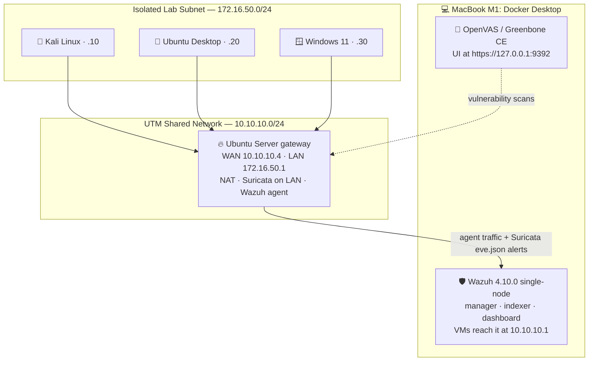

# Home SOC Lab: Wazuh SIEM + Suricata NIDS + OpenVAS on Apple Silicon


A hands-on security operations lab built on a single **M1 MacBook**. It covers the three core jobs of a small SOC:

| Job | Tool | Where it runs |
|---|---|---|
| 🛡️ **Watch the hosts** | Wazuh SIEM + agents | Manager in Docker on the Mac; an agent on every VM |
| 🌐 **Watch the network** | Suricata NIDS | Ubuntu gateway in front of an isolated VM subnet |
| 🔎 **Find the weaknesses** | OpenVAS (Greenbone CE) | Docker on the Mac, next to Wazuh |

The targets are four **UTM virtual machines** (Ubuntu Server, Ubuntu Desktop, Kali Linux and Windows 11), with **Kali** used as the attacker.

The lab was built in three parts. Each part documents **every problem I hit and how I resolved it**, with the original screenshots, so anyone building something similar can skip the dead ends.

## 🗺️ The Three Parts

| | Part | What it covers | Problems solved |
|---|---|---|---|
| 1️⃣ | **[Deploying Wazuh SIEM for a UTM Virtual Lab on Apple Silicon](part-1-wazuh-siem/README.md)** | Wazuh 4.10.0 in Docker on the Mac, agents on all four VMs, a location-independent manager address, and Lab 1: SSH brute force from Kali → detection → Active Response | 13 |
| 2️⃣ | **[Integrating a Suricata NIDS into the Existing SIEM & VM Network](part-2-suricata-nids/README.md)** | Turning Ubuntu Server into a NAT gateway, isolating the client VMs, Suricata on the gateway, alerts forwarded to Wazuh, custom per-source alert descriptions | 8 |
| 3️⃣ | **[Adding Vulnerability Scanning with OpenVAS (Greenbone CE)](part-3-openvas/README.md)** | Greenbone in Docker next to Wazuh, the `nginx`/`gsad` front-door confusion, a host-port 443 clash with the Wazuh dashboard, and the **first scans of every VM** | 6 |

**27 documented problems in total**, each with symptom, root cause, fix and screenshots.

## 🏗️ Current Architecture



How the lab grew:

- **Part 1:** every VM on the flat `10.10.10.0/24` shared network, reporting straight to Wazuh.
- **Part 2:** the client VMs move behind the gateway, so Suricata sees all of their traffic.
- **Part 3:** OpenVAS joins Wazuh on the Mac and scans every VM, including those behind the gateway.

## 📊 Lab Status & Roadmap

**Working ✅**

- [x] Wazuh SIEM in Docker with agents on all four VMs, and a manager address that survives Wi-Fi changes
- [x] SSH brute force from Kali detected in Wazuh (3,610 authentication-failure alerts)
- [x] Isolated lab subnet behind a NAT gateway, with persistent routing
- [x] Suricata alerts in Wazuh with per-source descriptions (`Kali Linux`, `Ubuntu Desktop`, …)
- [x] OpenVAS running next to Wazuh; first scan reports for the gateway (4.8 Medium), Kali and Ubuntu Desktop (2.6 Low)

**Open ⏳**

- [ ] Active Response: prove an automatic block triggered by a **live** Hydra attack ([Part 1](part-1-wazuh-siem/README.md#42-active-response-why-nothing-was-blocked-bottleneck-10))
- [ ] Windows 11: confirm the agent reports through the gateway, and finish its OpenVAS scan
- [ ] Fix the gateway's Medium finding and prove it with a re-scan
- [ ] **Part 4 idea: detection engineering.** Real attacks from Kali (Nmap scans, brute force, persistence on Windows with Sysmon), each mapped to MITRE ATT&CK, with custom Wazuh rules and written analysis

## 🔥 Selected Problems

| Problem | Part |
|---|---|
| Wazuh's all-in-one installer refuses an ARM64 VM, so the stack runs in Docker on the Mac instead | [1 · #1](part-1-wazuh-siem/README.md#bottleneck-1-native-installer-rejects-the-arm64-vm) |
| Agent runs, but the dashboard shows none: agent 4.14.7 > manager 4.10.0 | [1 · #4](part-1-wazuh-siem/README.md#bottleneck-4-agent-is-running-but-the-dashboard-says-no-agents-registered) |
| All agents drop when the Mac changes Wi-Fi, fixed by pointing them to UTM's `10.10.10.1` | [1 · #7](part-1-wazuh-siem/README.md#bottleneck-7-every-agent-disconnected-after-the-mac-changed-wi-fi) |
| Brute force detected (3,610 alerts), but Active Response never blocks | [1 · Lab 1](part-1-wazuh-siem/README.md#42-active-response-why-nothing-was-blocked-bottleneck-10) |
| Agents behind the gateway are "disconnected" while running: no NAT | [2 · #5](part-2-suricata-nids/README.md#bottleneck-5-agents-behind-the-gateway-show-disconnected-no-nat) |
| A custom decoder takes down the whole Wazuh manager and API | [2 · #7](part-2-suricata-nids/README.md#bottleneck-7-custom-decoder-takes-the-wazuh-manager-and-api-down) |
| Everything breaks again after a reboot: NAT rules weren't persistent | [2 · #8](part-2-suricata-nids/README.md#bottleneck-8-every-agent-disconnected-again-after-a-reboot-nat-not-persistent) |
| Greenbone and Wazuh both want host port 443 on the same Docker Desktop | [3 · #5](part-3-openvas/README.md#bottleneck-5-port-443-is-already-taken-by-the-wazuh-dashboard) |

## 🎯 Skills Demonstrated

- **SIEM deployment and operations:** containerized Wazuh, agent enrollment and version management, rule and decoder behaviour, API troubleshooting
- **Network security monitoring:** Suricata on a gateway choke point, custom signatures, EVE JSON ingestion, alert enrichment
- **Vulnerability management:** Greenbone CE deployment, per-host targets and tasks, reading severity and trends
- **Networking:** subnet isolation, NAT/masquerading, IP forwarding, static addressing, persistence across reboots
- **Incident-style troubleshooting:** reading component logs to find root causes, and documenting symptom → cause → fix
- **Offensive testing for validation:** Hydra and Nmap from Kali against owned lab machines

## 📁 Repository Structure

```text
cs-home-lab/
├── README.md                      # this overview
├── part-1-wazuh-siem/
│   ├── README.md                  # Part 1: Wazuh in Docker, agents, Lab 1 (brute force + Active Response)
│   ├── configs/                   # manager Active Response block, custom-drop.sh
│   └── screenshots/               # 35 screenshots
├── part-2-suricata-nids/
│   ├── README.md                  # Part 2: gateway, isolated subnet, Suricata → Wazuh
│   ├── configs/                   # gateway script, netplan, suricata, wazuh rules
│   └── screenshots/               # 31 screenshots
└── part-3-openvas/
    ├── README.md                  # Part 3: Greenbone CE next to Wazuh, first scans
    ├── configs/                   # the docker-compose port fix
    └── screenshots/               # 13 screenshots
```

## 🧰 Stack

| Layer | Technology |
|---|---|
| Host | MacBook M1 (ARM64), macOS |
| Hypervisor | UTM (Shared Network + isolated network) |
| SIEM | Wazuh 4.10.0 (manager, indexer, dashboard) via `wazuh-docker` single-node |
| NIDS | Suricata 8.0 (af-packet on the gateway LAN interface, ET Open + custom rules) |
| Vulnerability scanning | OpenVAS / Greenbone Community Edition (Docker, UI at `https://127.0.0.1:9392`) |
| Endpoints | Ubuntu Server 26.04, Ubuntu Desktop 26.04, Windows 11, Kali Linux 2026.2 |
| Attack tooling | Hydra, Nmap, ping |

## 🧠 Key Takeaways

1. **Match versions exactly.** Wazuh agents must not be newer than the manager. Pin the package and hold it.
2. **Use addresses that don't move.** On UTM Shared Network the Mac is always `10.10.10.1`.
3. **"Running" isn't "connected."** When an agent is up but shows disconnected, check the network path (routing, NAT, firewall) first.
4. **Make every change persistent.** `sysctl -w`, `iptables -A`, and `ip addr` are all lost on reboot.
5. **Read the component's own log.** `agent-auth`, `ossec.log`, `suricata.log`, and `docker logs` named the real cause every time.
6. **Use built-in parsing first.** Wazuh already decodes Suricata EVE JSON. A custom decoder took the manager down.
7. **Check host ports before adding a stack.** Two Docker stacks on one Mac can't both publish port 443.
8. **Verify AI-generated instructions.** Several suggested fixes in this build were wrong. The docs call them out where they happened.

---

*Personal learning lab. All offensive testing and scanning run only against machines I own, inside an isolated network. IP addresses in the text are examples and are blurred in all screenshots; no credentials or agent keys are included.*
