# Part 1: Deploying Wazuh SIEM for a UTM Virtual Lab on Apple Silicon

> ⬅️ [Back to overview](../README.md) · Next: [Part 2: Suricata NIDS integration](../part-2-suricata-nids/README.md)


-000000?logo=apple&logoColor=white)

Part 1 builds the SIEM for the lab:

- a **Wazuh 4.10.0 single-node stack** (manager, indexer, dashboard) in Docker on an M1 MacBook,
- **Wazuh agents** on four UTM virtual machines (Ubuntu Server, Ubuntu Desktop, Windows 11, Kali Linux),
- a first detection lab: **SSH brute force from Kali**, detected by Wazuh and answered with **Active Response**.

It also documents the **13 problems I hit along the way and how I solved each one**, with the original screenshots.

> [!NOTE]
> All IP addresses in this document are **examples**: `10.10.10.0/24` for the UTM shared network (the Mac is `10.10.10.1`). IP and MAC addresses in the screenshots are blurred. Adjust the addresses for your own environment. The Mac's home Wi-Fi address is written as `<MAC_WIFI_IP>`, and the dashboard password is never shown.

## 📑 Table of Contents

1. [Lab Topology](#1-lab-topology)
2. [Build Guide](#2-build-guide)
3. [Bottlenecks & How They Were Resolved](#3-bottlenecks--how-they-were-resolved)
4. [Lab 1: SSH Brute Force → Detection → Active Response](#4-lab-1-ssh-brute-force--detection--active-response)
5. [Lessons Learned](#5-lessons-learned)

## 1. Lab Topology

At the end of Part 1, every VM sits on UTM's **Shared Network** and reports straight to the Mac. (In [Part 2](../part-2-suricata-nids/README.md), the client VMs move behind an Ubuntu gateway.)

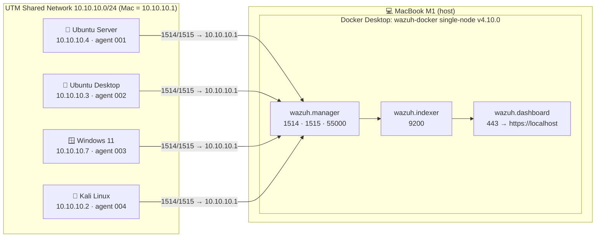

| Component | Where | Notes |
|---|---|---|
| Wazuh manager, indexer, dashboard | Docker on the Mac | `wazuh/wazuh-*:4.10.0` images (amd64, emulated on ARM) |
| Agents | Every VM | **Must be 4.10.0**. An agent newer than the manager is rejected. |
| Manager address used by agents | `10.10.10.1` | UTM shared-network host IP. It stays the same when the Mac changes Wi-Fi. |

## 2. Build Guide

### Step 1: Run the Wazuh stack in Docker on the Mac ([Bottlenecks 1–3](#bottleneck-1-native-installer-rejects-the-arm64-vm))

In Docker Desktop, go to **Settings → Resources** and give Docker **≥ 6–8 GB RAM and 4 CPUs**. The indexer needs a lot of memory.

```bash
git clone https://github.com/wazuh/wazuh-docker.git -b v4.10.0 --depth 1
cd wazuh-docker/single-node
docker compose -f generate-indexer-certs.yml run --rm generator   # one-time TLS certificates
docker compose up -d                                              # first pull is slow on Apple Silicon
docker compose ps
```

Open `https://localhost` and accept the self-signed certificate. Log in as `admin` with the password set in `docker-compose.yml` (`INDEXER_PASSWORD`). **Change it** afterwards.

### Step 2: Install a matching 4.10.0 agent on each Linux VM ([Bottleneck 4](#bottleneck-4-agent-is-running-but-the-dashboard-says-no-agents-registered))

```bash
# Ubuntu / Kali (ARM64 or x86 is picked up automatically from the repo)
curl -s https://packages.wazuh.com/key/GPG-KEY-WAZUH | sudo gpg --dearmor -o /usr/share/keyrings/wazuh.gpg
echo "deb [signed-by=/usr/share/keyrings/wazuh.gpg] https://packages.wazuh.com/4.x/apt/ stable main" \
  | sudo tee /etc/apt/sources.list.d/wazuh.list
sudo apt-get update
sudo WAZUH_MANAGER="10.10.10.1" WAZUH_AGENT_NAME="$(hostname)" apt-get install -y wazuh-agent=4.10.0-1
sudo apt-mark hold wazuh-agent               # never let apt upgrade it past the manager
sudo systemctl daemon-reload && sudo systemctl enable --now wazuh-agent
sudo grep ^status /var/ossec/var/run/wazuh-agentd.state   # → status='connected'
```

### Step 3: Install the Windows 11 agent ([Bottleneck 5](#bottleneck-5-windows-agent-stuck-in-pending--duplicate-agent-name))

Run in PowerShell as Administrator, one command at a time:

```powershell
Invoke-WebRequest -Uri "https://packages.wazuh.com/4.x/windows/wazuh-agent-4.10.0-1.msi" -OutFile "$env:TEMP\wazuh-agent.msi"
msiexec.exe /i "$env:TEMP\wazuh-agent.msi" /q WAZUH_MANAGER="10.10.10.1" WAZUH_AGENT_NAME="taron-win11"
Start-Sleep 15; NET START WazuhSvc
```

### Step 4: Check from the Mac

```bash
docker exec -it single-node-wazuh.manager-1 /var/ossec/bin/agent_control -l
```

### Day-to-day operations

| Task | Command (Mac, in `wazuh-docker/single-node`) |
|---|---|
| Stop / start the SIEM | `docker compose stop` / `docker compose start` |
| Recreate containers (e.g. after deleting them in Docker Desktop) | `docker compose up -d`. Volumes with agents, keys, and config are kept. |
| ⚠️ Wipe everything | `docker compose down -v`. **Deletes all volumes**, so every agent must re-enroll. |
| Free disk after pulls | `docker image prune`. Don't use `docker system prune -a` while the stack is stopped: it deletes the Wazuh images. |

## 3. Bottlenecks & How They Were Resolved

| # | Symptom | Root cause | Fix |
|---|---|---|---|
| 1 | `wazuh-install.sh`: *"must be run on a 64-bit system"* | All-in-one installer doesn't support the ARM64 VM | Run the Wazuh stack in **Docker on the Mac** |
| 2 | `no such service: generator`; image pull takes ~20 min | Cert generator is a separate compose file; amd64 images are emulated | `generate-indexer-certs.yml`; be patient on first pull |
| 3 | Dashboard: *Invalid username or password* | Guessed password ≠ password in `docker-compose.yml` | Read `INDEXER_PASSWORD` from the compose file |
| 4 | Agent running, dashboard shows **no agents** | Agent **4.14.7** > manager **4.10.0** | Install `wazuh-agent=4.10.0-1` + `apt-mark hold` |
| 5 | Windows: service invalid → `pending` → *Duplicate agent name* | MSI still installing; old registration left on the manager | Wait for MSI; `agent-auth -A <new-name>` or remove the old agent |
| 6 | *Dashboard server is not ready yet* / *API is down* / token error | Stack restarting; stale daemon PIDs after an abrupt stop | Wait 1–2 min; `wazuh-control restart`; clear browser session |
| 7 | All agents disconnected after the Mac changed Wi-Fi | Agents pointed to the Mac's **Wi-Fi IP** | Point every agent to **`10.10.10.1`** |
| 8 | Powered-off VM still shows **Active** | Default disconnection timeout (10 min) | `<agents_disconnection_time>` in `<global>` |
| 9 | Kali: `command not found`, arch mismatch, `postinst` failure | Wrong (amd64) package on ARM64; broken dpkg state | Install the **arm64** 4.10.0 package with the manager IP set |
| 10 | Brute force detected, but attacker never blocked | Manager config overwritten; wrong rule ID; `firewall-drop` input / nftables issues | Restore config, bind to rule **5760**, custom `iptables-legacy` script |
| 11 | Dashboard: API **Offline** / *Could not select any API entry* | `wazuh-apid` never started (stale `start-script-lock`) | Remove the lock, start the API, restart the stack |
| 12 | Ubuntu Server agent disconnected again, version **v4.14.7** | `apt-get install --reinstall` pulled the latest agent | Purge, reinstall 4.10.0, hold, remove the stale ID, re-enroll |
| 13 | Deleted the containers in Docker Desktop by mistake | n/a | `docker compose up -d`; the volumes survived |

---

### Bottleneck 1: Native installer rejects the ARM64 VM

**Symptom.** The official all-in-one installer, run inside the Ubuntu Server VM, stopped immediately:


**Root cause.** The VM runs on an **M1 Mac**, so it's `aarch64`. The all-in-one installer's platform check doesn't accept this ARM64 Ubuntu release, and forcing it with `-i` (ignore checks) isn't a supported path.

**Fix.** Keep the VMs as **agents only** and run the **Wazuh central components in Docker Desktop on the Mac** using the official `wazuh-docker` single-node deployment. The images are `linux/amd64`, which Docker runs under emulation (you'll see a platform warning; it's expected).

---

### Bottleneck 2: Certificate generator "no such service" and very slow pulls

**Symptom.** `docker compose run --rm generator` returned `no such service: generator`. Suggested alternatives (`generate-certs.sh`, `generator.yml`) didn't exist either.

**Root cause.** In `wazuh-docker` v4.10.0 the certificate generator lives in its **own compose file**, not in `docker-compose.yml`.

**Fix.**

```bash
cd wazuh-docker/single-node
docker compose -f generate-indexer-certs.yml run --rm generator
```

> In the lab, the same result came from running the generator image directly and mounting `config/certs.yml` and `config/wazuh_indexer_ssl_certs/` into it. Either way, you should end up with `root-ca.pem`, `wazuh.indexer.pem`, `wazuh.dashboard.pem`, and more in `config/wazuh_indexer_ssl_certs/`.

The first `docker compose up -d` pulled roughly 1.5 GB of amd64 layers and took **about 20 minutes** on Apple Silicon. Later starts use the cached images.

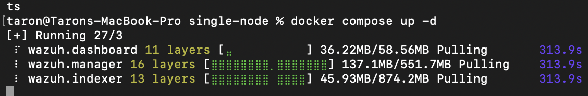

---

### Bottleneck 3: Dashboard rejects the admin password

**Symptom.** `https://localhost` showed the expected self-signed certificate warning. After that, the suggested default password was rejected.

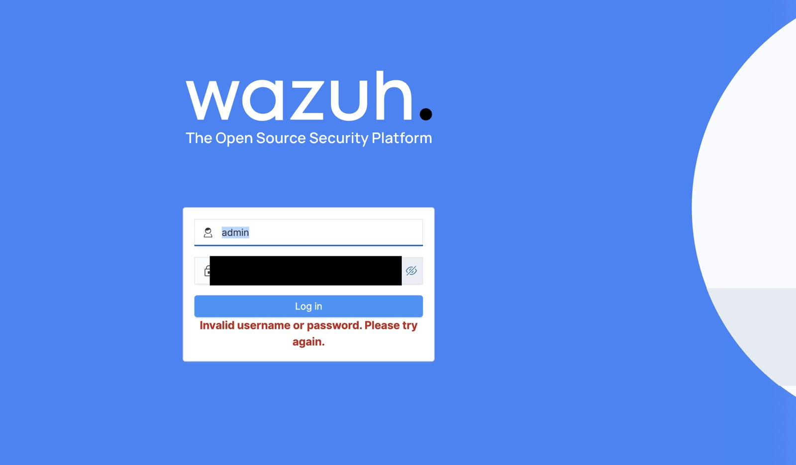

**Root cause.** The suggested password was a guess. The real one is whatever `docker-compose.yml` sets.

**Fix.**

```bash
grep -E "INDEXER_PASSWORD|DASHBOARD_USERNAME|DASHBOARD_PASSWORD|API_PASSWORD" docker-compose.yml
```

After logging in, **Server APIs** showed the manager API online:

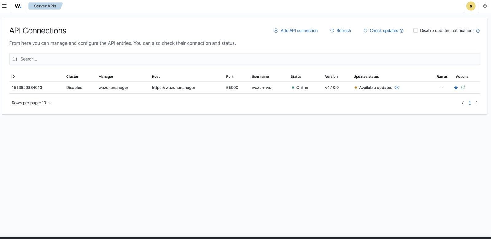

> 🔐 The compose defaults are public. Change them before the stack is reachable from anything other than your laptop.

---

### Bottleneck 4: Agent is running, but the dashboard says "no agents registered"

**Symptom.** The agent service on Ubuntu Server was `active (running)`, but the dashboard said *"This instance has no agents registered"*.

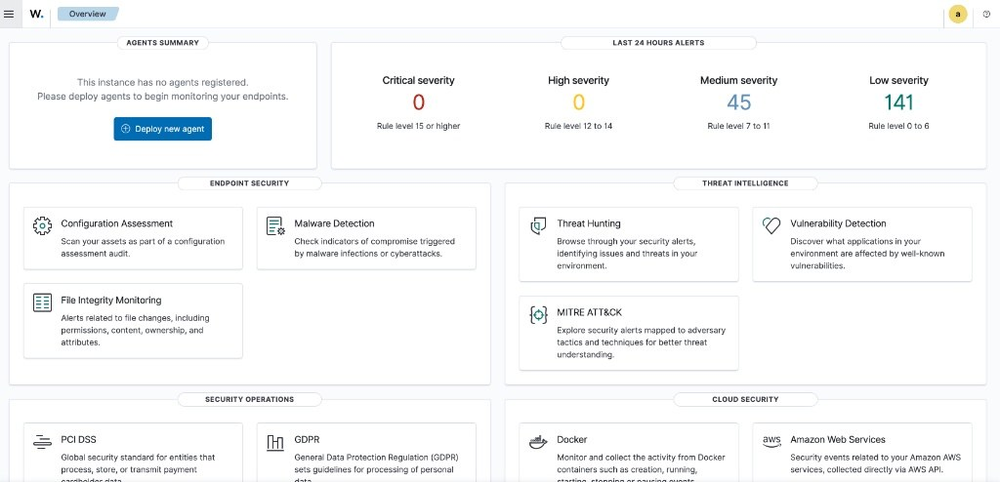

**Root cause.** Manual enrollment (`agent-auth`) showed the real error. The agent from the `4.x` apt repo was **4.14.7**, and the manager is **4.10.0**. Wazuh rejects agents that are newer than the manager.

| Enrollment error | Installed version |
|---|---|
| 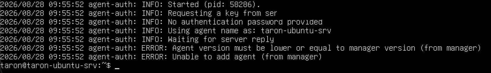 | 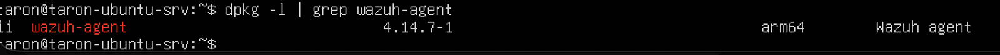 |

(`wazuh-agent -v` doesn't exist. Use `dpkg -l | grep wazuh-agent`.)

**Fix.** Downgrade, then pin the version:

```bash
sudo systemctl stop wazuh-agent
sudo apt-get purge -y wazuh-agent
sudo WAZUH_MANAGER="10.10.10.1" apt-get install -y wazuh-agent=4.10.0-1
sudo apt-mark hold wazuh-agent
sudo /var/ossec/bin/agent-auth -m 10.10.10.1
sudo systemctl enable --now wazuh-agent
```

| Key received | First active agent |
|---|---|
| 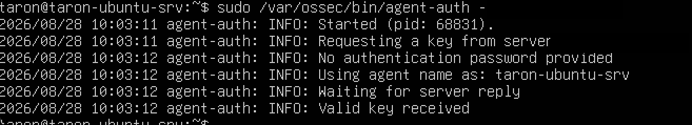 | 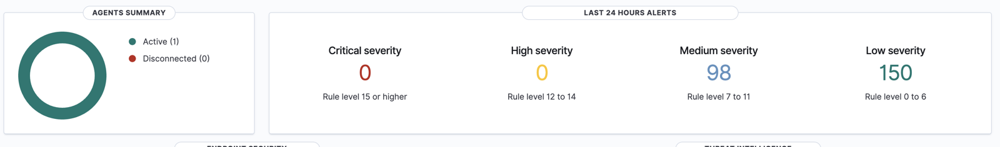 |

---

### Bottleneck 5: Windows agent stuck in `pending` / duplicate agent name

Three problems came up one after another on Windows 11:

1. `NET START WazuhSvc` said *"The service name is invalid"*. The MSI was still installing in the background (a multi-line PowerShell paste had also left the prompt stuck in `>>`). **Run one command at a time and wait about 15 s after `msiexec`.**
2. The agent state was `status='pending'`. It was installed but had never enrolled, because it couldn't reach the manager's port 1515 at the address it was given.
3. After connectivity was fixed, enrollment failed with *Duplicate agent name*. An earlier attempt had already registered `WIN-4C7UN2KL18C` on the manager.

| Service not installed yet | Pending | Duplicate name |
|---|---|---|
| 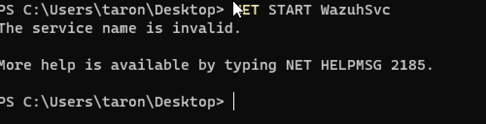 | 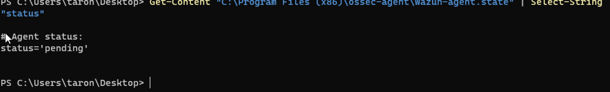 | 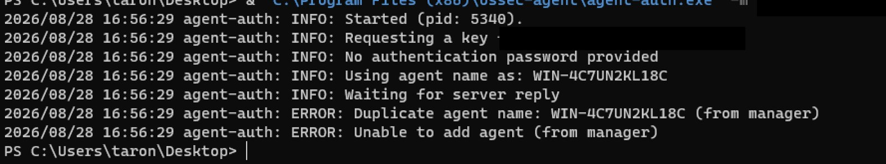 |

**Fix.** Enroll under a new explicit name, or delete the stale entry on the manager first:

```powershell
& "C:\Program Files (x86)\ossec-agent\agent-auth.exe" -m 10.10.10.1 -A taron-win11
Restart-Service -Name WazuhSvc
```

```bash
# Alternative (Mac): remove the stale registration, then enroll again from Windows
docker exec -it single-node-wazuh.manager-1 /var/ossec/bin/manage_agents -r <ID>
```

---

### Bottleneck 6: "Dashboard server is not ready yet" → "API is down" → token error

**Symptom.** After `docker compose stop` / `start`, which happened while the Mac was switching networks, the dashboard went through several errors:

| Not ready | API down | Token error |
|---|---|---|
| 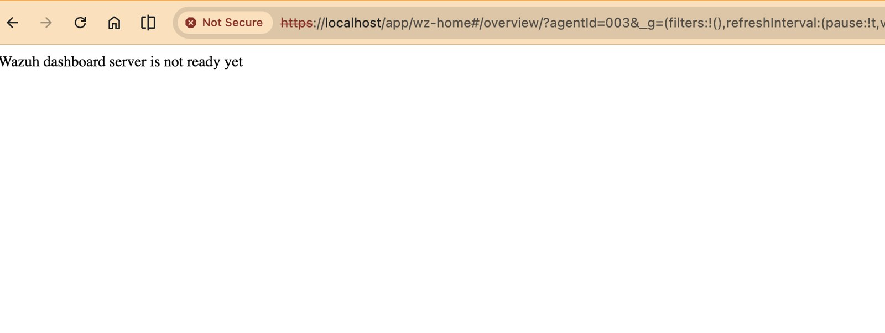 | 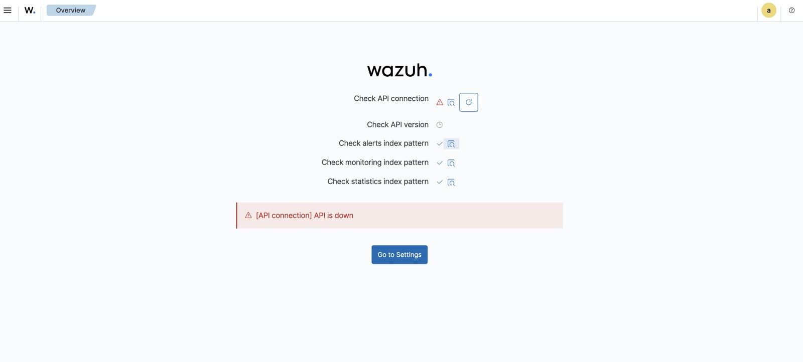 | 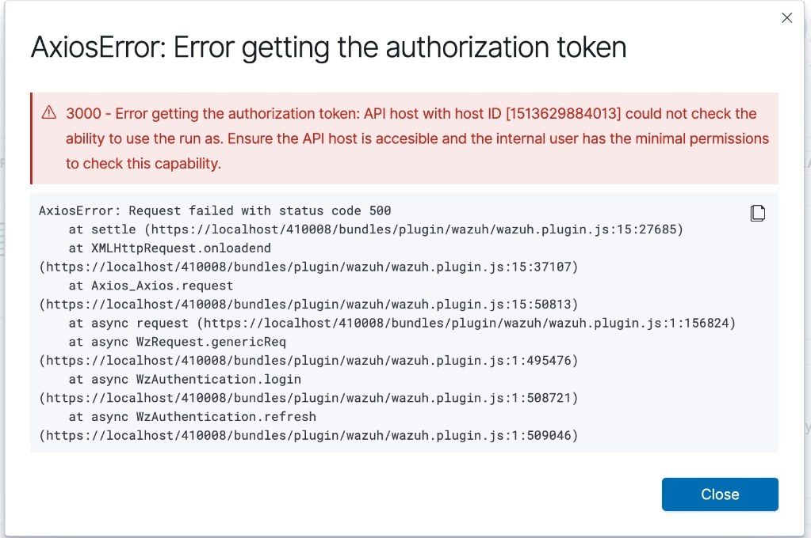 |

**Root cause and fix.**

- *Not ready yet*: the indexer (OpenSearch) takes **1–2 minutes** to start, and longer under emulation. **Wait**, then hard-refresh.
- *API is down*: after an abrupt stop, stale PID files kept `wazuh-apid` and `wazuh-modulesd` from starting. A control-script restart cleared them:

  ```bash
  docker exec -it single-node-wazuh.manager-1 /var/ossec/bin/wazuh-control restart
  ```

- *Error getting the authorization token*: the browser kept a session token from before the restart. **Log out, or clear the site's cookies for `localhost`**, and log in again.

---

### Bottleneck 7: Every agent disconnected after the Mac changed Wi-Fi

**Symptom.** Once the dashboard was back, all three agents were **disconnected**, even though their services were running.

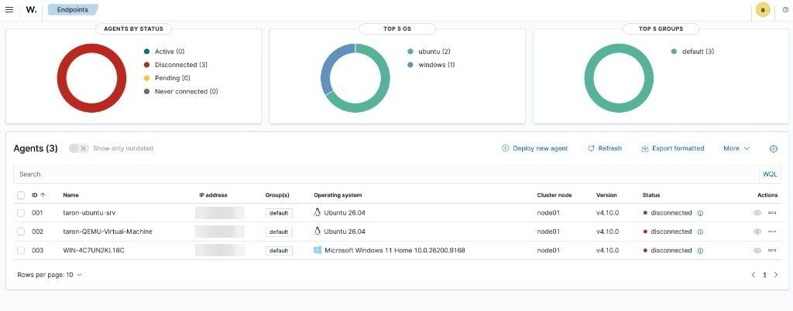

**Root cause.** The agents were configured with the **Mac's Wi-Fi IP** (`<MAC_WIFI_IP>`), which the router hands out. After changing networks, that address either changed or wasn't reachable from UTM's NAT network anymore:

| Agent config pointed at the Wi-Fi IP | `Connection timed out` |
|---|---|
| 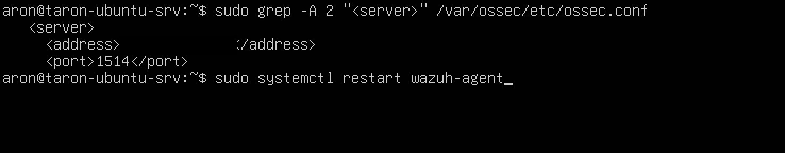 | 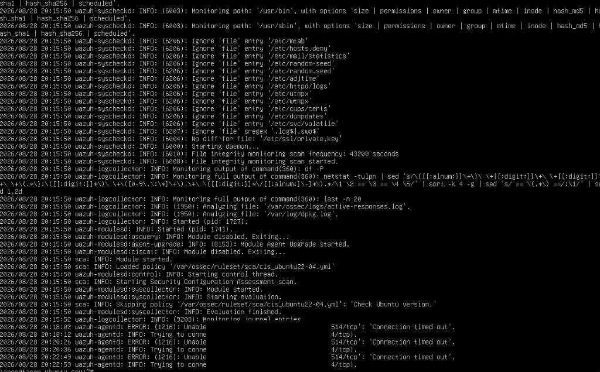 |

The VMs are on UTM's **Shared Network** (`10.10.10.0/24`). On that network, the Mac is **always `10.10.10.1`**, which is the VMs' default gateway, whatever Wi-Fi the Mac is on:

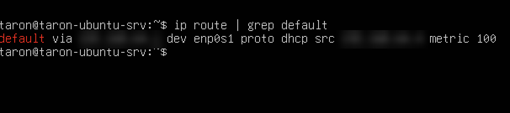

**Fix: use the address that never changes.** Run this on every Linux agent (on Windows, edit `C:\Program Files (x86)\ossec-agent\ossec.conf` the same way):

```bash
sudo sed -i 's|<address>.*</address>|<address>10.10.10.1</address>|' /var/ossec/etc/ossec.conf
sudo systemctl restart wazuh-agent
```

(Bridged mode was suggested too, but it isn't needed. Shared mode with `10.10.10.1` makes the lab independent of the network the laptop is on.)

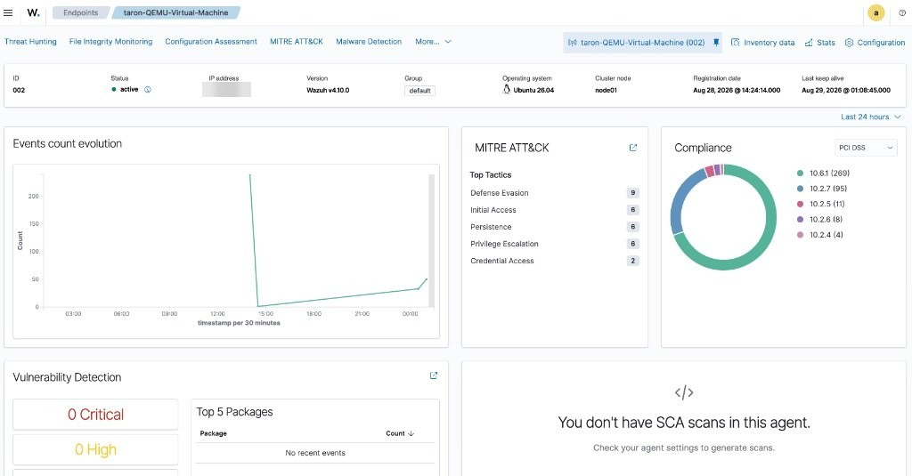

---

### Bottleneck 8: A powered-off VM keeps showing "Active"

**Symptom.** After a VM was shut down, the dashboard showed it as **Active** for several more minutes.

**Root cause.** Agents don't announce a shutdown. The manager marks an agent disconnected only after `agents_disconnection_time` passes without a keep-alive, and that was **10 minutes**:

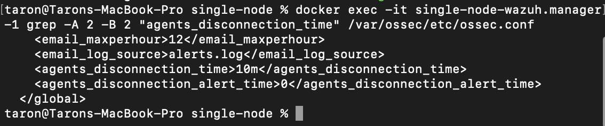

Two side issues made the edit harder:

- The manager image has **no `nano`**, so edit the file with `sed`, or `docker cp` it out and back in.
- Pasting several lines that include `# comments` and `<tags>` into **zsh** runs every line as its own command (`zsh: no such file or directory: global`). Paste one command at a time.

| No editor in the container | zsh multi-line paste |
|---|---|
| 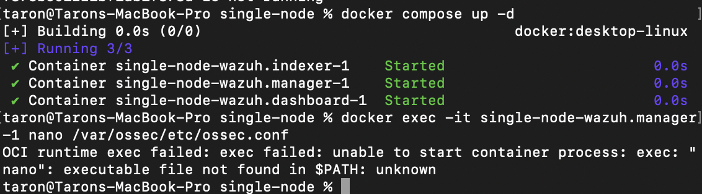 | 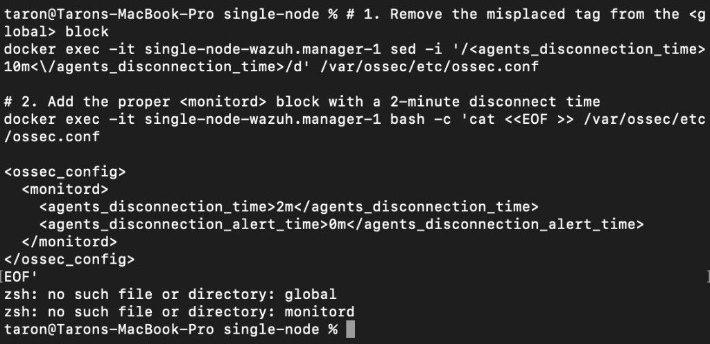 |

**Fix.** Change the value where it already is, in `<global>` (the documented place for this option), then restart:

```bash
docker exec -it single-node-wazuh.manager-1 sed -i \
  's|<agents_disconnection_time>10m</agents_disconnection_time>|<agents_disconnection_time>2m</agents_disconnection_time>|' \
  /var/ossec/etc/ossec.conf
docker restart single-node-wazuh.manager-1
```

`agent_control -l` is the quickest way to see the real state, without the dashboard's cache:

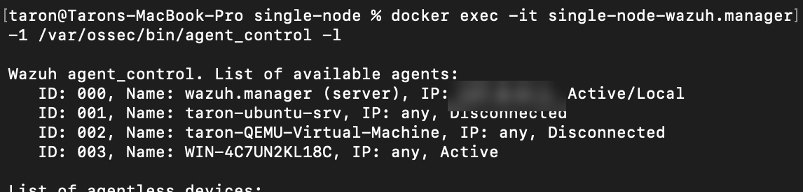

---

### Bottleneck 9: Installing the agent on Kali (ARM64)

**Symptom and root cause (a chain of three).**

1. After a "successful" `apt` install, `wazuh-agent-auth` was *command not found*. The package had **never installed**. (Also, the binary is called `agent-auth`, not `wazuh-agent-auth`.)
2. A direct `.deb` download failed: *package architecture (amd64) does not match system (arm64)*.
3. The arm64 package then failed in `postinst`, which left dpkg in a broken state.

| amd64 package on arm64 | postinst failure |
|---|---|
| 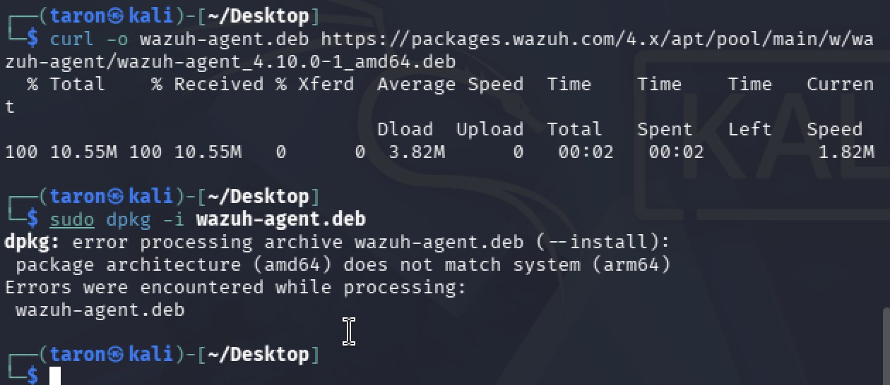 | 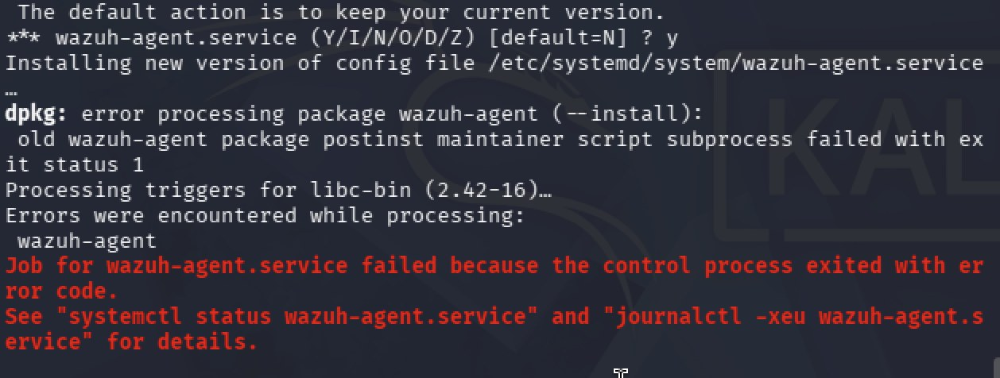 |

**Fix.** Clean up the broken package, then install the **arm64 4.10.0** build with the manager address set **during** installation, so `postinst` starts a correctly configured agent:

```bash
sudo dpkg --remove --force-remove-reinstreq wazuh-agent; sudo rm -rf /var/ossec
curl -o wazuh-agent.deb https://packages.wazuh.com/4.x/apt/pool/main/w/wazuh-agent/wazuh-agent_4.10.0-1_arm64.deb
sudo WAZUH_MANAGER='10.10.10.1' WAZUH_AGENT_NAME='kali-linux-vm' dpkg -i wazuh-agent.deb
sudo apt-mark hold wazuh-agent
sudo systemctl daemon-reload && sudo systemctl enable --now wazuh-agent
```

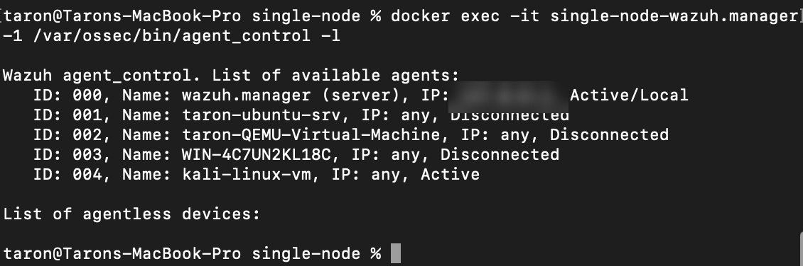

(The dashboard showed Kali as *never connected* for a short while after the CLI already reported **Active**. That's just the indexer catching up.)

---

### Bottleneck 10: Brute force is detected, but Active Response never blocks the attacker

Covered in detail in [Lab 1](#4-lab-1-ssh-brute-force--detection--active-response) below.

---

### Bottleneck 11: Dashboard API "Offline": *Could not select any API entry*

**Symptom.** After many manager config edits and restarts, the dashboard lost the API. `curl https://localhost:55000` returned `Connection reset by peer`.

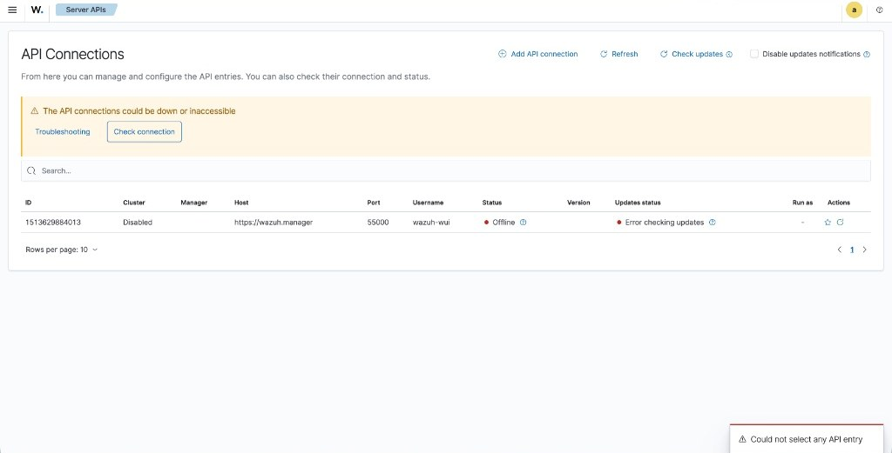

**Root cause.** The container log showed the manager's startup script was blocked:

```text
ERROR: Another instance is locking this process. If you are sure that no other instance
is running, please remove /var/ossec/var/start-script-lock
```

The lock was a **directory**, left behind by an interrupted start. As a result `wazuh-apid` never started. Port 55000 was published by Docker, but nothing was listening behind it.

**Fix.**

```bash
docker exec -it single-node-wazuh.manager-1 rm -rf /var/ossec/var/start-script-lock
docker compose down && docker compose up -d        # clean start of the whole stack
# If the API still doesn't come up, start it by hand to see the error:
docker exec -it single-node-wazuh.manager-1 /var/ossec/framework/python/bin/python3 /var/ossec/api/scripts/wazuh_apid.py
```

`{"title": "Unauthorized", ...}` from `curl` means the API is **up**: it's asking for a token. The dashboard went back to **Online**:

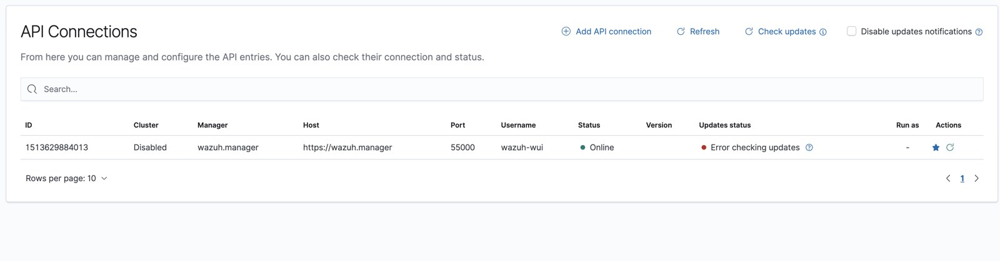

> A suggested "fix" was to rewrite the host in the dashboard's `wazuh.yml` (`https://wazuh.manager` → the container name). It failed with *Device or resource busy* (the file is bind-mounted) and wasn't needed. `wazuh.manager` is the correct compose service name.

---

### Bottleneck 12: Ubuntu Server agent silently upgraded to 4.14.7

**Symptom.** Agent 001 was disconnected again and the dashboard showed version **v4.14.7** in red.

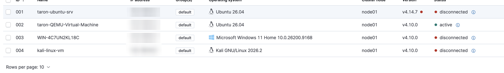

**Root cause.** While troubleshooting Active Response, `sudo apt-get install --reinstall wazuh-agent` was run to restore the stock scripts. With no version pinned, apt installed the **latest** agent. The incompatible-version problem from [Bottleneck 4](#bottleneck-4-agent-is-running-but-the-dashboard-says-no-agents-registered) came back.

**Fix.**

```bash
# Ubuntu Server
sudo apt-get purge -y wazuh-agent
sudo WAZUH_MANAGER="10.10.10.1" apt-get install -y wazuh-agent=4.10.0-1
sudo apt-mark hold wazuh-agent
# Mac: the old registration blocks re-enrollment ("Duplicate agent name"), so remove it
docker exec -it single-node-wazuh.manager-1 /var/ossec/bin/manage_agents -r 001
# Ubuntu Server
sudo systemctl restart wazuh-agent     # → "Valid key received" → Connected
```

The server re-enrolled as a **new ID**, which is why it appears as **agent 005** in Part 2.

---

### Bottleneck 13: Containers deleted from Docker Desktop by mistake

**Fix.** Deleting containers doesn't delete **named volumes**, and those hold agent registrations, keys, and config. Recreate the containers from the same compose file:

```bash
cd ~/wazuh-docker/single-node
docker compose up -d
```

Only `docker compose down -v` (or deleting the volumes) would have lost the data.

## 4. Lab 1: SSH Brute Force → Detection → Active Response

**Goal.** Attack `taron-ubuntu-srv` over SSH from Kali, watch Wazuh detect it, and have Wazuh block Kali's IP automatically.

### 4.1 Attack and detection ✅

```bash
# Kali
hydra -l root -P /usr/share/wordlists/metasploit/unix_passwords.txt 10.10.10.4 ssh -t 4
```

Hydra ended with *"all children were disabled due too many connection errors"*. That's sshd limiting it (`MaxAuthTries`, `MaxStartups`), not a failure of the test. On the target, `auth.log` was full of failed passwords from Kali (`10.10.10.2`):

| Attack | Evidence on the target |
|---|---|
| 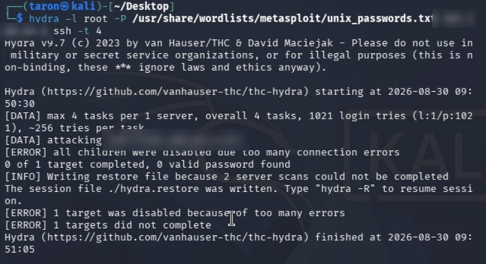 | 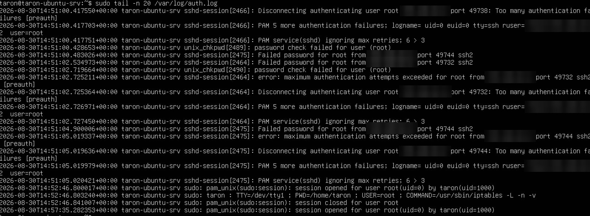 |

Wazuh picked it all up, with **3,610 authentication failures** on agent 001:

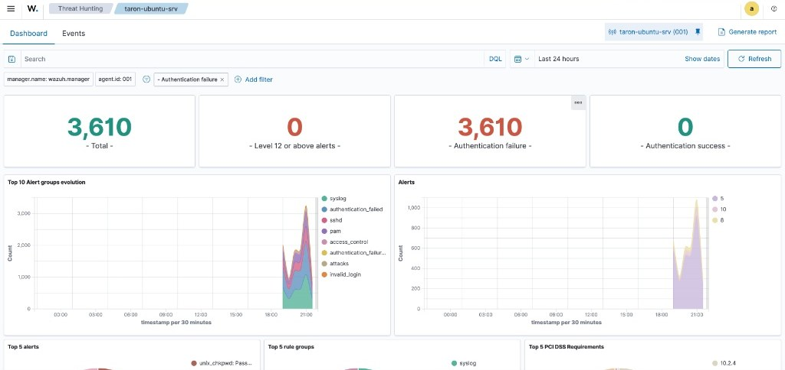

> 💡 If a test event doesn't appear, check **which view you're on**. The agent *overview* page doesn't list individual alerts. Use **Threat Hunting → Events**.

### 4.2 Active Response: why nothing was blocked (Bottleneck 10)

`iptables` on the target stayed empty, and `agent_control` couldn't even find the response:

| Empty firewall | `Selected active response does not exist` |
|---|---|
| 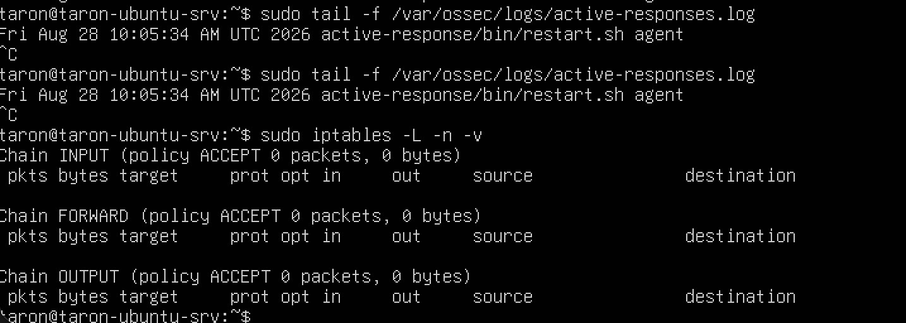 | 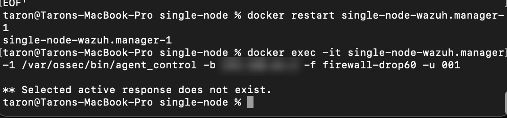 |

Four separate causes had to be removed:

| Cause | Detail |
|---|---|
| **Manager config overwritten** | A suggested `cat <<EOF > /var/ossec/etc/ossec.conf` replaced the whole manager config with only an `<active-response>` block. That wiped `<ruleset>`, `<remote>`, `<auth>` and more. Always **add** blocks to the existing file; never replace it. |
| **Wrong rule** | Bound to `5716`, which **never fired** in this lab (`grep 5716 alerts.log` only matched timestamps). Rule **`5760`** (*sshd: authentication failed*) fired on every attempt. |
| **Stock `firewall-drop`** | Manual tests logged *Invalid input format*: 4.x scripts expect a JSON message on stdin, not plain arguments. Ubuntu's default `iptables` is the **nftables** backend, while the rules were checked with `iptables-legacy`. |
| **Invalid `<location>`** | `defined-by-agent` isn't a valid value. Use `local` (run on the agent that raised the alert). |

A detour to avoid: a global `sed 's/<disabled>yes/<disabled>no/g'` on the **agent's** `ossec.conf` (meant to enable Active Response) turns on *every* disabled module. Change only the block you mean to change.

### 4.3 What worked

- **Manager:** a `custom-drop` command bound to rule 5760, added *inside* the existing `ossec.conf`. See [`configs/manager-active-response.xml`](configs/manager-active-response.xml).
- **Agent:** a small script that parses the execd JSON and calls `iptables-legacy`. See [`configs/custom-drop.sh`](configs/custom-drop.sh).

Given an execd-format message, the script blocked Kali:

```text
$ sudo iptables-legacy -L INPUT -n -v
Chain INPUT (policy ACCEPT 6264 packets, 8177K bytes)
 pkts bytes target     prot opt in     out     source               destination
    0     0 DROP       all  --  *      *       10.10.10.2         0.0.0.0/0
```

> [!IMPORTANT]
> The block was verified by **feeding the script an execd-format message**. A fully automatic block triggered by a live Hydra run wasn't confirmed before the lab moved on to Part 2. That's the first item to re-test.
>
> The script in this repo is a cleaned-up version of the one used in the lab. The lab version fell back to "grab the first IP-looking string" when JSON parsing failed, which could block the wrong host. This version parses the JSON only, validates the IP, and supports `delete`, so the 600 s timeout unblocks correctly.

## 5. Lessons Learned

- **Match versions exactly.** Agent ≤ manager. Pin with `=4.10.0-1` and `apt-mark hold`. An unpinned "reinstall" is really an upgrade.
- **Pick an address that doesn't move.** On UTM Shared Network, the host is always `10.10.10.1`.
- **Read the component's own log first.** `agent-auth` output, `ossec.log`, and `docker logs` named the real cause every time (version mismatch, duplicate name, timeouts, the start-script lock).
- **Never overwrite a whole config to add one block**, and avoid global `sed` replacements on XML configs.
- **Paste one command at a time** into zsh and PowerShell. Multi-line pastes with comments or tags break both.
- **Give the stack time.** On Apple Silicon (emulated amd64), the indexer and API take minutes to start after a restart.
- **Named volumes are your backup.** `docker compose up -d` recovers deleted containers. `down -v` doesn't.
- **Verify AI-suggested fixes against the docs.** Several suggestions in this build were wrong (a non-existent `generator` service, `defined-by-agent`, overwriting `ossec.conf`, moving settings to the wrong section) and made things worse before they got better.

---

⬅️ [Back to overview](../README.md) · Next: [Part 2: Suricata NIDS integration](../part-2-suricata-nids/README.md)

*Personal learning lab. All offensive testing runs only inside an isolated network that I own.*
