# Part 2: Integrating a Suricata NIDS into an Existing Wazuh SIEM & Virtual Lab Network

> ⬅️ [Back to overview](../README.md) · Previous: [Part 1: Wazuh SIEM deployment](../part-1-wazuh-siem/README.md) · Next: [Part 3: OpenVAS](../part-3-openvas/README.md)


This project **adds network-based intrusion detection to a home lab that was already running**. The lab already had:

- a **Wazuh SIEM** (manager, indexer, and dashboard) running in Docker on a MacBook, and
- several **UTM virtual machines** (Ubuntu Desktop, Ubuntu Server, Kali Linux, Windows 11), each with a Wazuh agent installed.

The goal was to add **Suricata** without rebuilding anything. The Ubuntu Server VM became a **router/gateway** for an isolated VM subnet, Suricata inspects traffic on its internal interface, and the alerts go to Wazuh through the gateway's existing agent.

This README covers the final architecture, the design decisions, a build guide, and the **8 problems I hit during the integration and how I solved each one**, with the original screenshots.

> [!NOTE]
> All IP addresses in this document are **examples**: `10.10.10.0/24` for the UTM shared network (the Mac is `10.10.10.1`) and `172.16.50.0/24` for the isolated lab subnet. IP and MAC addresses in the screenshots are blurred. Adjust the addresses for your own environment.

## 📑 Table of Contents

1. [Starting Point vs. End Result](#1-starting-point-vs-end-result)
2. [Network Topology](#2-network-topology)
3. [Why a Network-Based IDS (NIDS) and Not Only HIDS?](#3-why-a-network-based-ids-nids-and-not-only-hids)
4. [Build Guide](#4-build-guide)
5. [Bottlenecks & How They Were Resolved](#5-bottlenecks--how-they-were-resolved)
6. [Final Result](#6-final-result)
7. [Lessons Learned & Next Steps](#7-lessons-learned--next-steps)

## 1. Starting Point vs. End Result

| | Before | After |
|---|---|---|
| **Detection** | Host-based only (Wazuh agents on each VM) | Host-based **plus** network-based (Suricata on the gateway) |
| **Network** | All VMs on UTM's shared network, talking to the Mac directly | Client VMs on an **isolated subnet**, reachable only through the Ubuntu Server gateway |
| **Ubuntu Server** | Ordinary VM with a Wazuh agent | **Router + NAT + Suricata sensor** with a Wazuh agent forwarding `eve.json` |
| **Alerts** | Host events only | Suricata alerts in Wazuh with **per-source dynamic descriptions** |

## 2. Network Topology

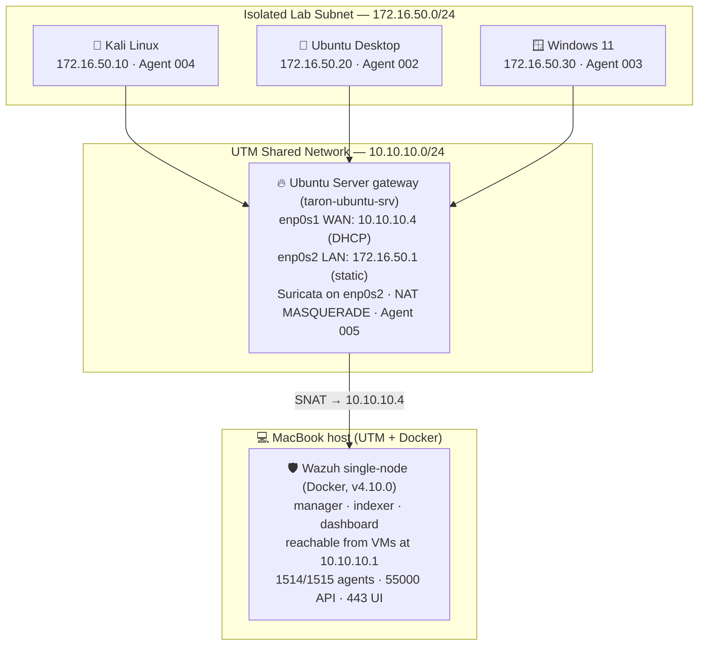

### Addressing

| Node | Role | Interface / IP | Default gateway | Wazuh agent |
|---|---|---|---|---|
| **MacBook (host)** | Runs UTM + Wazuh Docker stack | `10.10.10.1` (UTM shared-network host IP) | n/a | Manager |
| **Ubuntu Server** | Gateway / NAT / Suricata sensor | WAN `enp0s1` `10.10.10.4`<br>LAN `enp0s2` `172.16.50.1` | `10.10.10.1` | `005` |
| **Kali Linux** | Attacker / test traffic | `172.16.50.10/24` | `172.16.50.1` | `004` |
| **Ubuntu Desktop** | Client | `172.16.50.20/24` | `172.16.50.1` | `002` |
| **Windows 11** | Client | `172.16.50.30/24` | `172.16.50.1` | `003` |

**Why agents point to `10.10.10.1`:** the Mac's Wi-Fi/LAN IP changes from network to network, but UTM's shared-network host address stays the same. Every agent uses `<address>10.10.10.1</address>`, so the lab keeps working wherever the laptop is. The client VMs reach that address **only through the gateway's NAT**.

## 3. Why a Network-Based IDS (NIDS) and Not Only HIDS?

The Wazuh agents already provided **host-based** detection (FIM, logs, SCA). The missing piece was visibility into traffic on the wire.

1. **One sensor for everything.** All client traffic has to cross the gateway, so one Suricata instance on `enp0s2` sees every flow. Nothing extra needs to be installed on Kali, Ubuntu Desktop, or Windows.
2. **Works on every OS.** Signatures apply at the network layer, so Windows, Linux, and anything added later are covered the same way, even when an agent is missing or broken.
3. **An attacker can't turn it off.** A compromised VM can stop its own agent, but it can't stop the gateway from seeing its packets.
4. **More realistic.** A perimeter sensor feeding a SIEM mirrors a real SOC setup. Isolating the subnet also forces the traffic through the sensor.
5. **Defense in depth.** NIDS covers packets, scans, and protocol anomalies; HIDS covers processes, files, and logins. Wazuh correlates both.

**Why the Ubuntu Server and not the Ubuntu Desktop?** Suricata on a single desktop VM only sees that VM's own traffic. Turning the headless server into the **gateway** gives it a real choke point, and it has no GUI competing for resources.

## 4. Build Guide

> Each step links to the bottleneck it caused, so you can skip the problems I ran into.

### Step 1: Create the isolated network (UTM)

- Gateway VM: **two NICs**. NIC 1 is *Shared Network* (WAN). NIC 2 is on the network shared with the client VMs (LAN).
- Client VMs: **one NIC**, on the LAN network only.

### Step 2: Configure the gateway interfaces ([Bottleneck 1](#bottleneck-1-isolated-subnet-not-reachable-broken-netplan-yaml--stray-dhcp-address))

```bash
sudo nano /etc/netplan/50-cloud-init.yaml     # see configs/netplan/gateway-50-cloud-init.yaml
sudo chmod 600 /etc/netplan/*.yaml
sudo netplan apply
```

### Step 3: Enable routing + NAT, persistently ([Bottleneck 5](#bottleneck-5-agents-behind-the-gateway-show-disconnected-no-nat) & [8](#bottleneck-8-every-agent-disconnected-again-after-a-reboot-nat-not-persistent))

```bash
sudo ./configs/gateway/setup-gateway.sh enp0s1 172.16.50.0/24
```

### Step 4: Give each client VM a static IP

- **Linux** (see [`configs/netplan/client-01-netcfg.yaml`](configs/netplan/client-01-netcfg.yaml)): address `.10`/`.20`, gateway `172.16.50.1`, DNS `1.1.1.1`.
- **Windows 11:** *Settings → Network & internet → Ethernet → IP assignment → Edit → Manual*: `172.16.50.30/24`, gateway `172.16.50.1`.
- Test from each VM: `ping 172.16.50.1` (gateway), then `nc -zv 10.10.10.1 1514` (Wazuh manager through NAT).

### Step 5: Install and configure Suricata on the gateway ([Bottleneck 2](#bottleneck-2-suricata-runs-but-loads-0-rules-and-binds-to-a-non-existent-eth0) & [6](#bottleneck-6-only-kali-triggers-alerts-other-vms-are-ignored))

```bash
sudo add-apt-repository ppa:oisf/suricata-stable -y
sudo apt-get update && sudo apt-get install -y suricata jq
sudo suricata-update                                   # ET Open ruleset → suricata.rules
sudo cp configs/suricata/local.rules /var/lib/suricata/rules/local.rules
sudo nano /etc/suricata/suricata.yaml                  # see configs/suricata/suricata.yaml.snippet
sudo suricata -T -c /etc/suricata/suricata.yaml -v     # must end with "successfully loaded"
sudo systemctl enable --now suricata
```

### Step 6: Forward Suricata alerts to Wazuh ([Bottleneck 3](#bottleneck-3-wazuh-agent-refuses-to-start-after-adding-suricata-invalid-log_format))

Add [`configs/wazuh/agent-suricata-localfile.xml`](configs/wazuh/agent-suricata-localfile.xml) to the gateway agent's `/var/ossec/etc/ossec.conf` (`log_format` must be **`json`**), then:

```bash
sudo systemctl restart wazuh-agent
```

### Step 7: Add dynamic alert descriptions on the manager ([Bottleneck 7](#bottleneck-7-custom-decoder-takes-the-wazuh-manager-and-api-down))

Run this on the Mac. Copy the rules into the container and restart it. **Do not add a custom decoder.**

```bash
docker cp configs/wazuh/local_rules.xml single-node-wazuh.manager-1:/var/ossec/etc/rules/local_rules.xml
docker restart single-node-wazuh.manager-1
```

### Step 8: Generate test traffic

```bash
ping -c 1000 10.10.10.1          # from any client VM, continuous ICMP through the gateway
nmap 172.16.50.1                  # from Kali
```

In the Wazuh dashboard, go to **Threat Hunting → Events** and filter with `rule.groups: "suricata"`. Add the columns `data.src_ip` and `data.dest_ip`.

## 5. Bottlenecks & How They Were Resolved

| # | Symptom | Root cause | Fix |
|---|---|---|---|
| 1 | Kali can't ping its gateway | Flattened netplan YAML; stray DHCP address on the LAN NIC | Fix the YAML indentation, `chmod 600`, remove the DHCP address |
| 2 | Suricata processes 0 signatures; `eth0: No such device` | No rules downloaded or listed; default config sniffs `eth0` | `suricata-update`, add `local.rules`, sniff `enp0s2` only |
| 3 | `wazuh-agent` won't restart | `<log_format>suricata</log_format>` is not a valid value | Use `<log_format>json</log_format>` |
| 4 | Alerts arrive, but the source IP column is empty | Wrong field name (`data.srcip`); a `<ruleset>` wrapper in the decoder crashed the manager | Use `data.src_ip` / `data.dest_ip`; no wrapper in decoder files |
| 5 | Kali shows **disconnected** while its agent is running | Gateway doesn't forward or NAT the isolated subnet | `ip_forward=1` + `MASQUERADE` |
| 6 | Only Kali's pings raise alerts | Test rule hard-coded Kali's IP | Use `$HOME_NET` as the source |
| 7 | Dashboard: **"API is down"** | Invalid custom decoder stopped `wazuh-analysisd` / `wazuh-modulesd` | Delete the decoder; use rules only; restart the container |
| 8 | After a reboot, every agent except the gateway is disconnected | `sysctl` / `iptables` changes were runtime-only | Re-apply, then persist with `sysctl.conf` + `iptables-persistent` |

---

### Bottleneck 1: Isolated subnet not reachable (broken netplan YAML + stray DHCP address)

**Symptom.** After setting Kali to a static `172.16.50.10` with gateway `172.16.50.1`, every ping failed with *Destination Host Unreachable*, including pings to the gateway.

| Kali static config | Result |
|---|---|
| 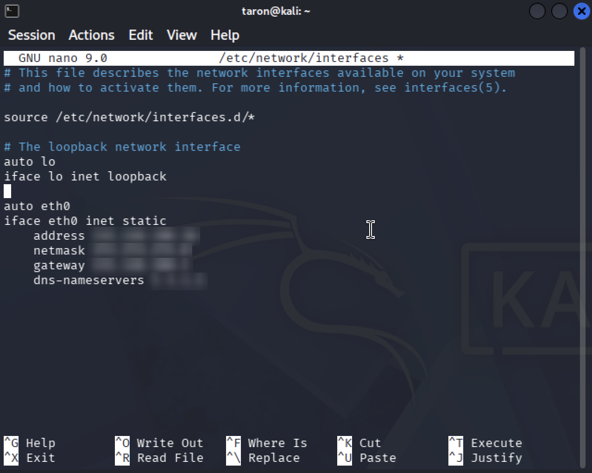 | 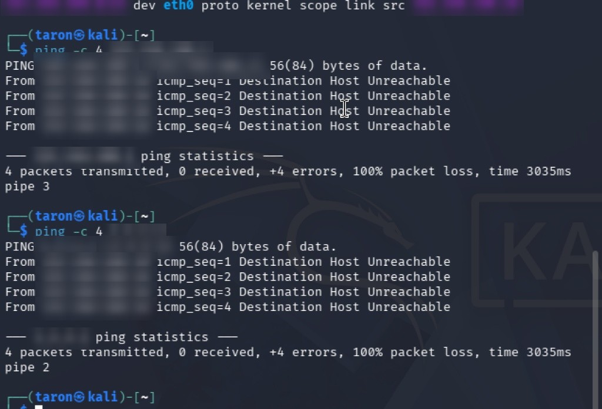 |

**Root cause (three problems at once):**

1. The gateway's LAN NIC `enp0s2` still had a UTM DHCP address (`10.20.30.7`). `172.16.50.1` didn't exist yet.
   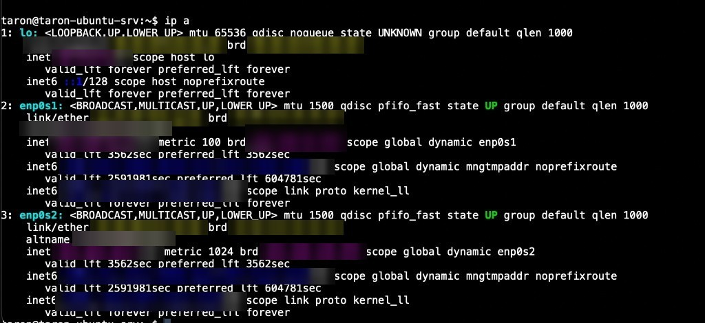
2. The netplan file had been pasted as **one flattened line**. YAML depends on indentation, so the file was invalid.
   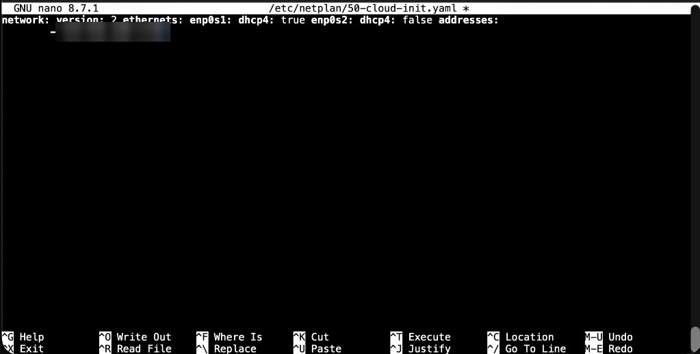
3. Kali also kept a **second, DHCP-assigned address** (`10.20.30.5`) next to the static one. That's a path around the gateway, which defeats the isolation.
   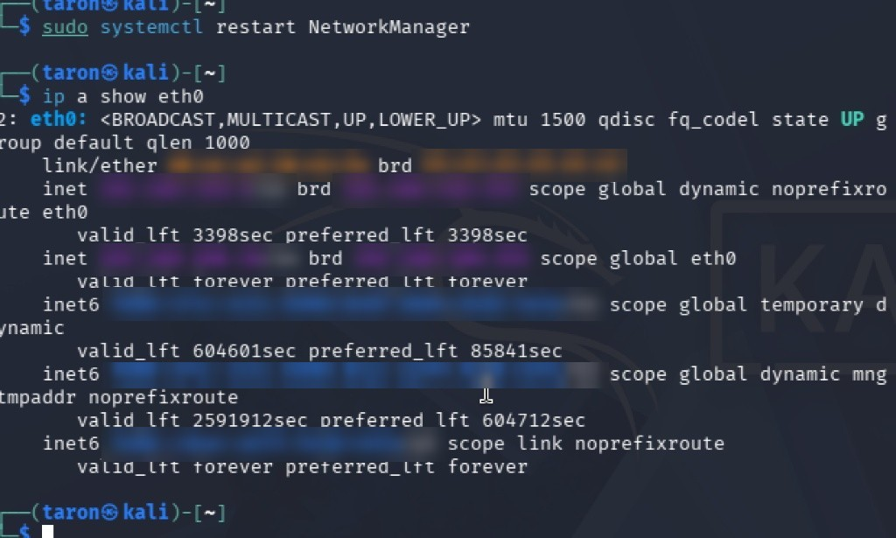

**Fix.**

```bash
# Gateway: rewrite /etc/netplan/50-cloud-init.yaml with correct indentation, then
sudo chmod 600 /etc/netplan/50-cloud-init.yaml     # silences "Permissions ... are too open"
sudo netplan apply

# Kali: drop the stray DHCP lease so the gateway is the only way out
sudo ip addr del 10.20.30.5/24 dev eth0
```

| Correct netplan | Stray address removed, single default route |
|---|---|
| 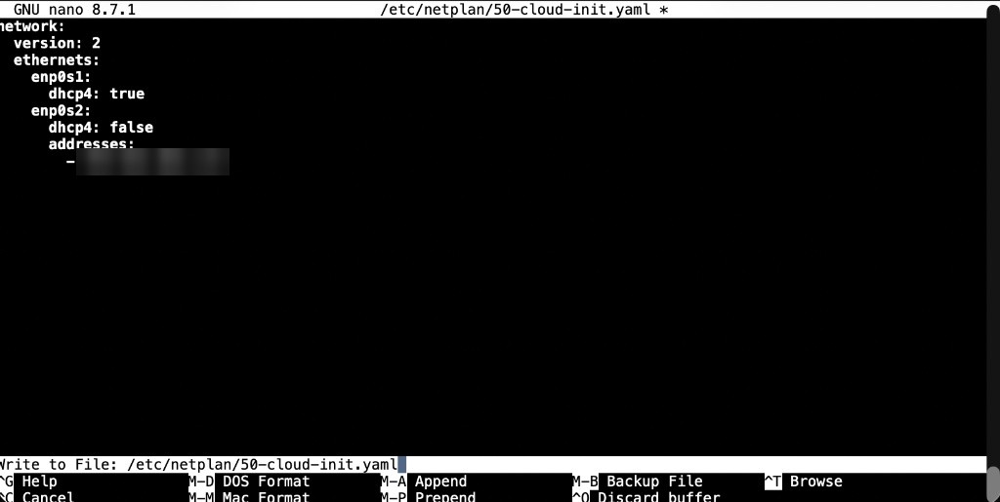 | 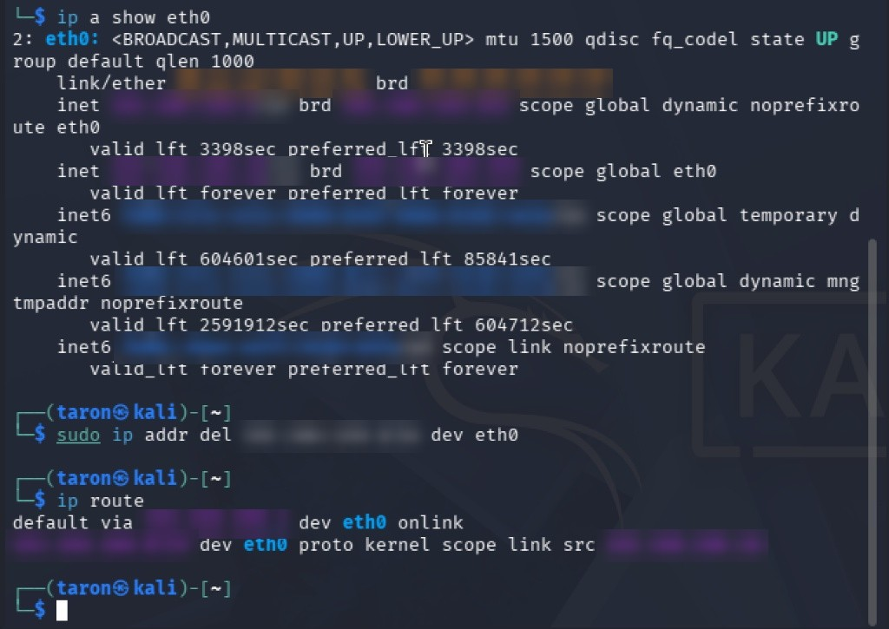 |

`netplan apply` also warned that the file permissions were too open, which the `chmod 600` above fixes:

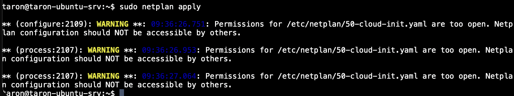

**Result:** Kali reaches the gateway.

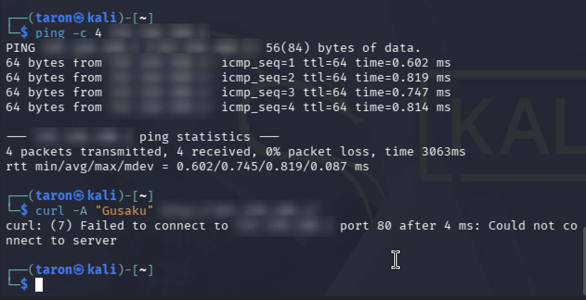

---

### Bottleneck 2: Suricata runs but loads 0 rules and binds to a non-existent `eth0`

**Symptom.** Pings crossed the gateway, but `eve.json` never contained an `"event_type":"alert"`. `suricata.log` showed:

```text
Warning: detect: No rule files match the pattern /var/lib/suricata/rules/suricata.rules
Warning: detect: 1 rule files specified, but no rules were loaded!
Info: detect: 0 signatures processed.
Error: af-packet: eth0: failed to find interface: No such device
Error: threads: thread "W#01-eth0" failed to start
```

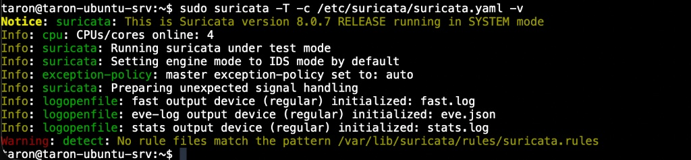

**Root cause.**

- The ruleset had never been downloaded, and the custom `local.rules` file wasn't listed under `rule-files:`.
- The default `af-packet` section still listed `eth0`. The capture thread for that missing interface crashed and took the workers with it.

**Fix.**

```bash
sudo suricata-update                      # populate suricata.rules
# suricata.yaml → rule-files: [suricata.rules, local.rules]
# suricata.yaml → af-packet: only "- interface: enp0s2"
sudo suricata -T -c /etc/suricata/suricata.yaml -v
sudo systemctl restart suricata
```

| `af-packet` bound to the LAN NIC | `HOME_NET` includes the lab subnet |
|---|---|
| 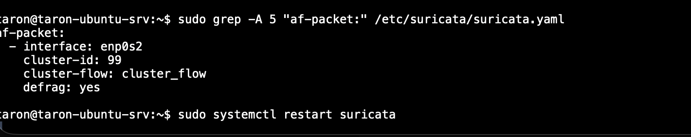 | 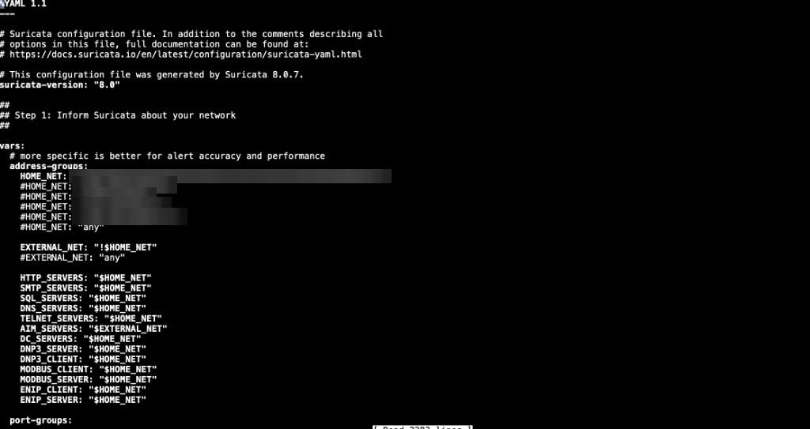 |

**Diagnostic tip:** `sudo tcpdump -i enp0s2 icmp` shows whether packets reach the sensor at all. If they do, the problem is Suricata's config, not the network.

---

### Bottleneck 3: Wazuh agent refuses to start after adding Suricata (invalid `log_format`)

**Symptom.** After the `eve.json` block was added to the gateway's `ossec.conf`, every `systemctl restart wazuh-agent` failed.

| Config added | Restart fails every time |
|---|---|
| 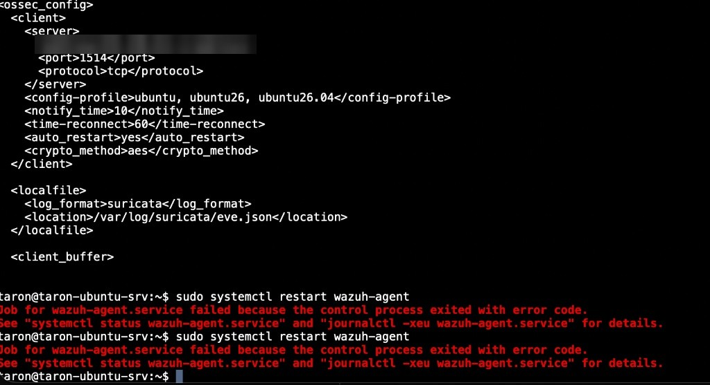 | 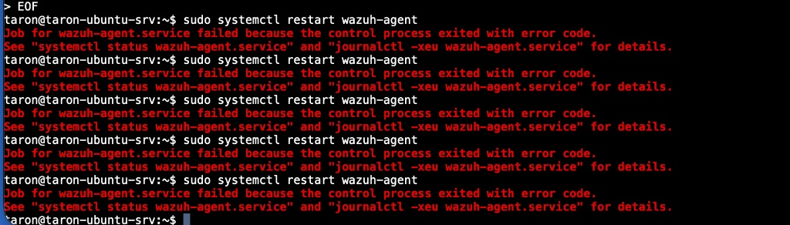 |

**Root cause.** `/var/ossec/logs/ossec.log` gave the answer:

```text
wazuh-logcollector: ERROR: (1235): Invalid value for element 'log_format': suricata.
wazuh-logcollector: ERROR: (1202): Configuration error at 'etc/ossec.conf'.
```

Wazuh has **no `suricata` log format**. EVE output is plain JSON, and Wazuh's built-in Suricata ruleset matches it after the JSON decoder has parsed it. Config pasted from a web page can also contain non-breaking spaces (`\xa0`) that break XML parsing. `sudo sed -i 's/\xa0/ /g' /var/ossec/etc/ossec.conf` removes them.

**Fix.**

```bash
sudo sed -i 's|<log_format>suricata</log_format>|<log_format>json</log_format>|' /var/ossec/etc/ossec.conf
sudo systemctl restart wazuh-agent
sudo grep -a "eve.json" /var/ossec/logs/ossec.log   # → "Analyzing file: '/var/log/suricata/eve.json'"
```

**Result:** after test traffic from Kali, the first Suricata alert appeared in Wazuh (rule `86601`).

| Before: no Suricata events | Test traffic from Kali | First alert in Wazuh |
|---|---|---|
| 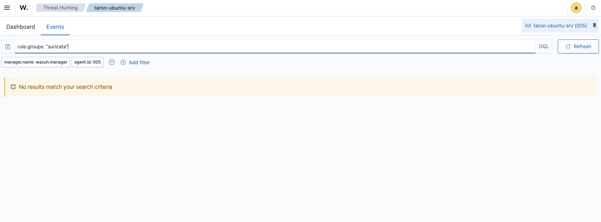 | 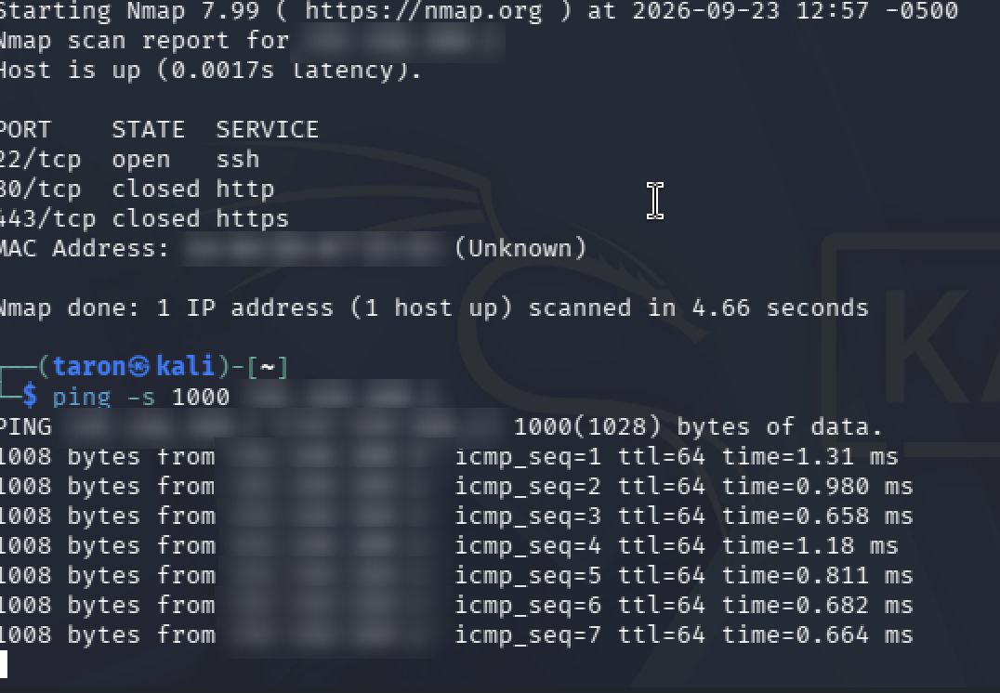 | 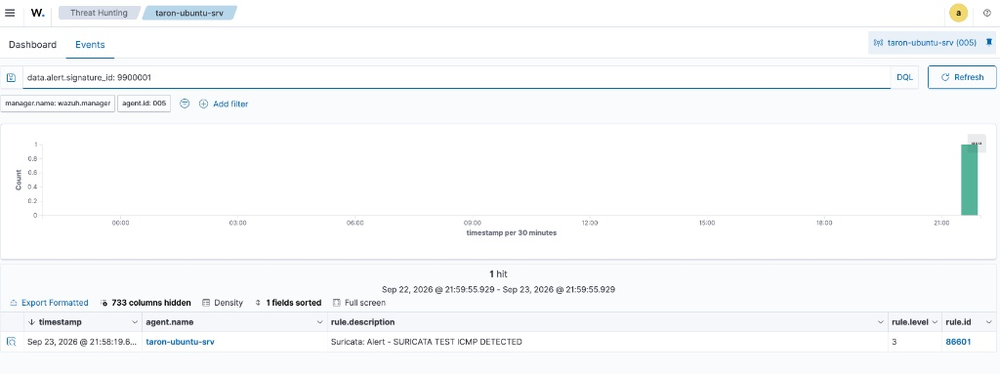 |

---

### Bottleneck 4: Alerts arrive, but you can't see which VM sent the traffic

**Symptom.** All Suricata alerts are reported by the **gateway's** agent (`taron-ubuntu-srv`), so `agent.name` doesn't identify the VM that sent the traffic. The `data.srcip` / `data.dstip` columns were empty (`-`).

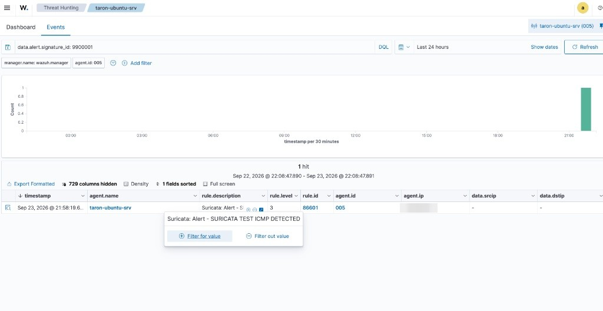

**Root cause.**

- **Wrong field names.** Wazuh's JSON decoder keeps Suricata's original keys, so the fields are **`data.src_ip`** and **`data.dest_ip`**, with underscores.
- **A side problem.** A custom decoder was also tried. It was wrapped in `<ruleset>…</ruleset>`, which decoder files do not allow. `wazuh-analysisd` refused to start, and **every manager daemon stopped**:

  ```text
  wazuh-analysisd: ERROR: (1230): Invalid element in the configuration: 'ruleset'.
  wazuh-analysisd: CRITICAL: (1202): Configuration error at 'etc/decoders/local_decoder.xml'.
  ```

  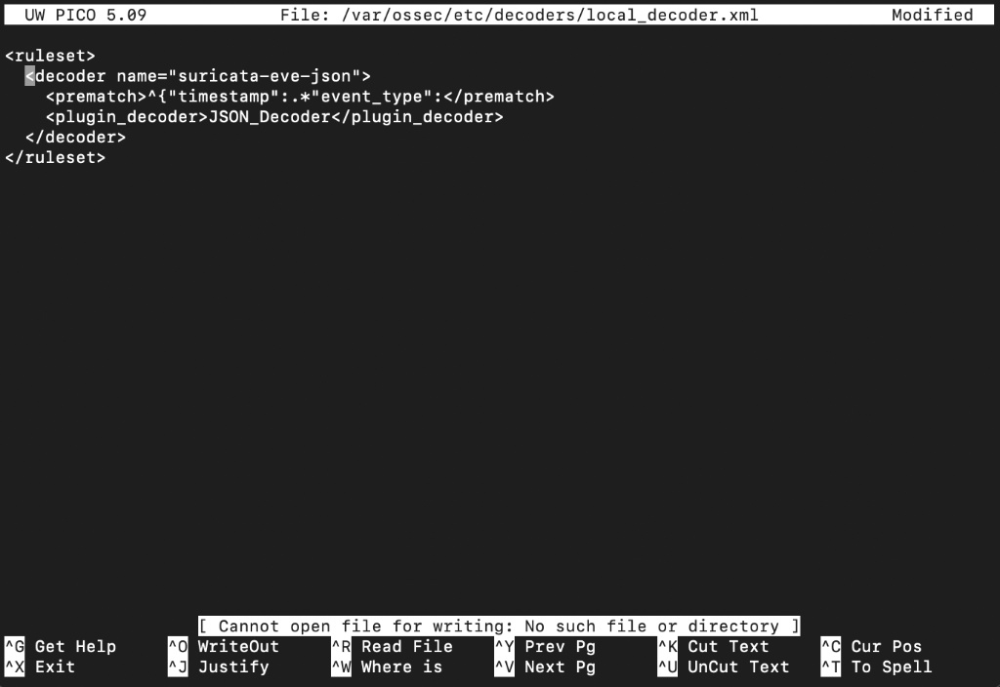

**Fix.** Remove the wrapper (or the whole custom decoder), start the manager again, and add `data.src_ip` / `data.dest_ip` as columns.

```bash
docker exec -it single-node-wazuh.manager-1 /var/ossec/bin/wazuh-control start
docker exec -it single-node-wazuh.manager-1 /var/ossec/bin/wazuh-control status
```

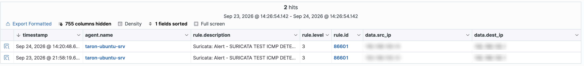

> 💡 The manager runs **inside Docker**, so its files must be edited through `docker exec`. Editing `/var/ossec/...` on the Mac fails with *"Cannot open file for writing: No such file or directory"*.

---

### Bottleneck 5: Agents behind the gateway show "disconnected" (no NAT)

**Symptom.** After Kali moved into the isolated subnet, the dashboard showed it as **disconnected**, even though `systemctl status wazuh-agent` reported `active (running)`.

| Dashboard | Agent is running on Kali |
|---|---|
| 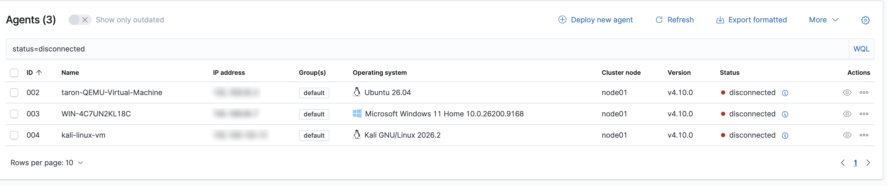 | 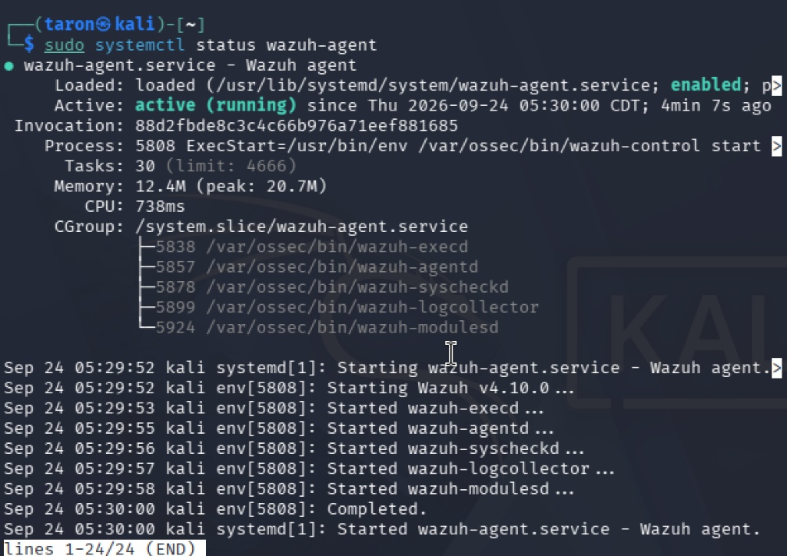 |

```text
wazuh-agentd: ERROR: (1216): Unable to connect to '[10.10.10.1]:1514/tcp': 'Connection timed out'.
```

**Root cause.** Packets from `172.16.50.10` reached the gateway, but the gateway was **not forwarding them and not NAT-ing them**. The Mac has no route back to `172.16.50.0/24`, so even forwarded packets could never get a reply.

> A detour that didn't help: pointing the agent at the Mac's Wi-Fi IP instead of `10.10.10.1`. That address also changes on every network. The fix is on the gateway, not the agent.

**Fix (on the gateway).**

```bash
sudo sysctl -w net.ipv4.ip_forward=1
sudo iptables -t nat -A POSTROUTING -s 172.16.50.0/24 -o enp0s1 -j MASQUERADE
```

**Check (on Kali):** port 1514 is now reachable through the gateway, and the agent reconnects.

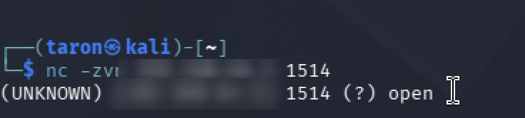

---

### Bottleneck 6: Only Kali triggers alerts; other VMs are ignored

**Symptom.** After Ubuntu Desktop was moved into the subnet (`172.16.50.20`), its pings produced no alerts. Every alert still came from `172.16.50.10`.

| Ubuntu Desktop on the isolated subnet | Alerts still only from Kali |
|---|---|
| 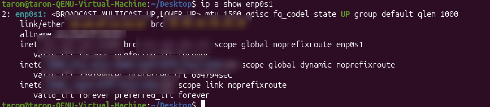 | 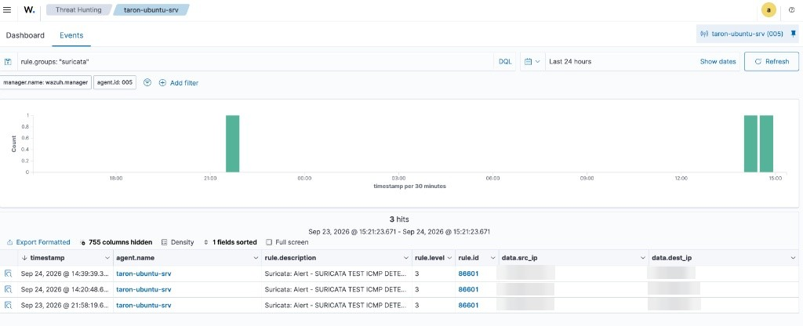 |

**Root cause.** The first test signature was written for Kali only:

```text
alert icmp 172.16.50.10 any -> any any (msg:"SURICATA TEST ICMP DETECTED"; sid:9900001; rev:1;)
```

**Fix.** Match the whole protected network ([`configs/suricata/local.rules`](configs/suricata/local.rules)):

```text
alert icmp $HOME_NET any -> any any (msg:"SURICATA TEST ICMP DETECTED"; sid:9900001; rev:2;)
```

```bash
sudo systemctl restart suricata
sudo tail -f /var/log/suricata/fast.log     # watch for the new source IP
```

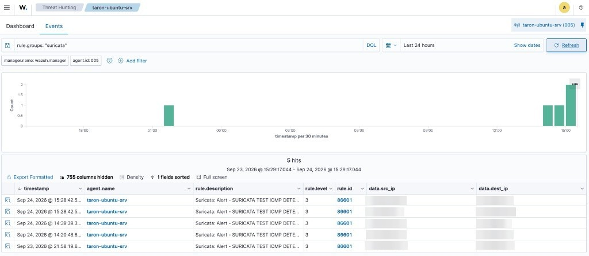

---

### Bottleneck 7: Custom decoder takes the Wazuh manager and API down

**Symptom.** To get alert descriptions like *"ICMP from Kali Linux"*, a custom decoder was added to `local_decoder.xml`. The dashboard then showed **"[API connection] API is down"**.

| Invalid decoder | Dashboard |
|---|---|
| 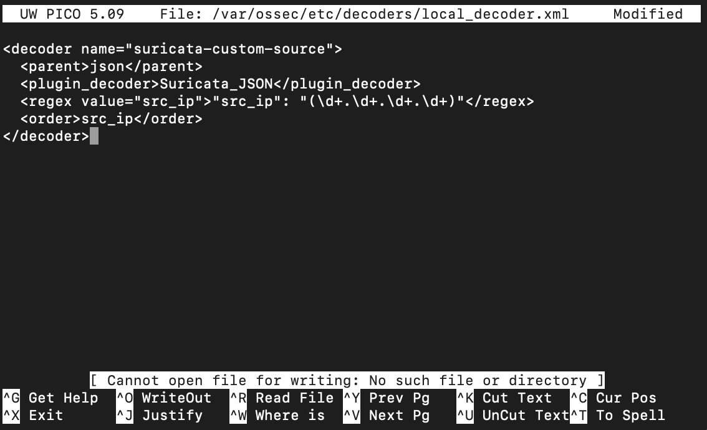 | 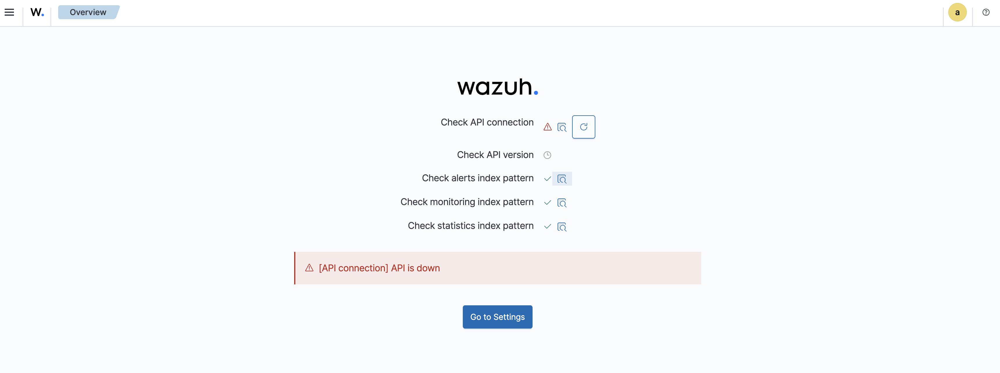 |

The details showed `wazuh-modulesd` had stopped, and the manager log contained `ERROR: Too many fields for JSON decoder`:

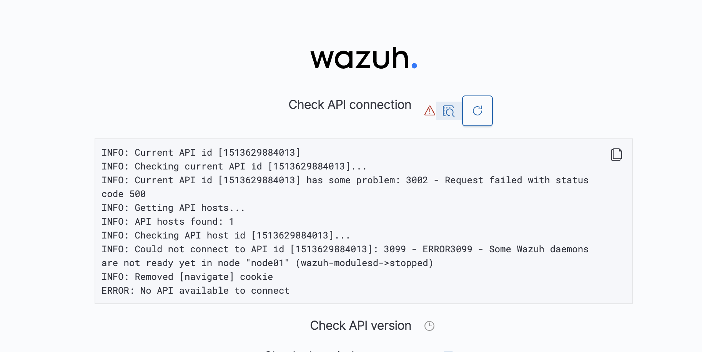

**Root cause.** The decoder was invalid in two ways:

- `<parent>suricata</parent>` / `<plugin_decoder>Suricata_JSON</plugin_decoder>` don't exist.
- A `<regex>` on top of JSON fields that were already decoded.

`wazuh-analysisd` rejected it, the dependent daemons stopped, and the dashboard lost the API. The decoder wasn't needed anyway: the built-in JSON decoder already exposes `src_ip`.

**Fix.** Delete the decoder, keep **rules only**, and restart the container so every daemon starts in the correct order. Starting daemons one at a time with `wazuh-control` left `modulesd` behind.

```bash
docker exec -it single-node-wazuh.manager-1 rm -f /var/ossec/etc/decoders/local_decoder.xml
docker cp configs/wazuh/local_rules.xml single-node-wazuh.manager-1:/var/ossec/etc/rules/local_rules.xml
docker restart single-node-wazuh.manager-1
docker exec -it single-node-wazuh.manager-1 tail -n 20 /var/ossec/logs/ossec.log
```

The rules ([`configs/wazuh/local_rules.xml`](configs/wazuh/local_rules.xml)) are children of built-in rule `86601` and match on `src_ip`:

```xml
<rule id="100001" level="3">
  <if_sid>86601</if_sid>
  <field name="src_ip">^172\.16\.50\.10$</field>
  <description>Suricata: ICMP Traffic Detected from Kali Linux (172.16.50.10)</description>
</rule>
```

> 💡 On Apple Silicon the `wazuh-manager` image runs under QEMU emulation, so the daemons are slow to start. Wait about 30–60 s after a restart before assuming something is broken.

---

### Bottleneck 8: Every agent disconnected again after a reboot (NAT not persistent)

**Symptom.** The next day, after the VMs were powered back on, only the gateway was active. Kali, Ubuntu Desktop, and Windows were all **disconnected**, although their agents were running.

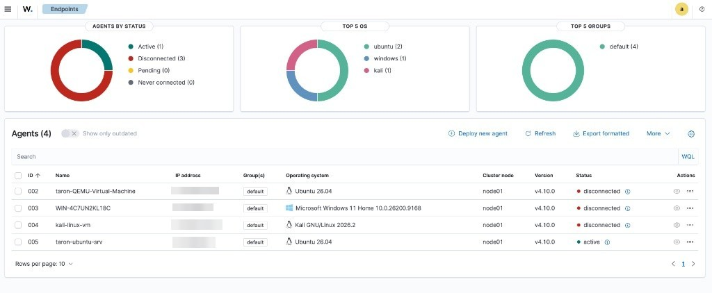

**Red herrings.** The first attempts treated this as a manager problem: restarting `wazuh-remoted`, re-exporting the agent key with `manage_agents -e`, and writing it into the client's `client.keys`. **None of these helped.** The keys were never the problem.

> 🔐 If you do end up re-importing keys, never paste or screenshot them publicly. `client.keys` entries are agent authentication secrets.

**Root cause.** The same as Bottleneck 5. `sysctl -w` and `iptables -A` only change **runtime** state, so rebooting the gateway wiped IP forwarding and the MASQUERADE rule. The gateway itself sits on the host network, so it stayed active, and that hid the real cause.

**Fix: re-apply the rules and make them permanent (on the gateway).**

```bash
ip route show                                  # confirm the WAN interface (enp0s1)
sudo sysctl -w net.ipv4.ip_forward=1
sudo iptables -t nat -A POSTROUTING -s 172.16.50.0/24 -o enp0s1 -j MASQUERADE
sudo iptables -A FORWARD -m conntrack --ctstate RELATED,ESTABLISHED -j ACCEPT
sudo iptables -A FORWARD -s 172.16.50.0/24 -j ACCEPT

echo "net.ipv4.ip_forward=1" | sudo tee /etc/sysctl.d/99-lab-gateway.conf
sudo apt install -y iptables-persistent
sudo netfilter-persistent save
```

Every agent came back **active** as soon as the gateway rules were in place, without touching the agents. [`configs/gateway/setup-gateway.sh`](configs/gateway/setup-gateway.sh) does all of the above in one step.

## 6. Final Result

Suricata alerts from the isolated subnet show up in Wazuh with **dynamic, per-source descriptions**. Custom rules `100001` (Kali) and `100002` (Ubuntu Desktop) fire next to the built-in `86601`:

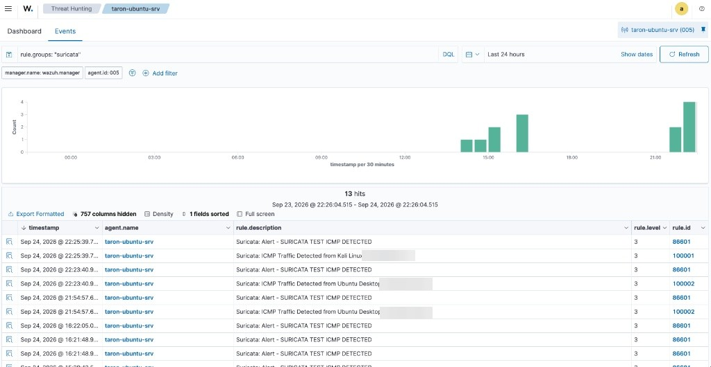

End-to-end pipeline:

```text
VM traffic ─► gateway enp0s2 ─► Suricata (af-packet) ─► /var/log/suricata/eve.json
          ─► Wazuh agent 005 (log_format json) ─► manager :1514 (via host 10.10.10.1)
          ─► built-in rule 86601 ─► local rules 100001–100003 ─► dashboard
```

## 7. Lessons Learned & Next Steps

**Lessons learned**

- **"Running" isn't "connected."** When an agent is `active (running)` but shows as disconnected, check the network path (routing, NAT, firewall) before keys or config.
- **Make every network change persistent.** `sysctl -w`, `iptables -A`, and `ip addr` all disappear on reboot. Bottleneck 8 was just Bottleneck 5 coming back.
- **Read the component's own log first.** `ossec.log`, `suricata.log`, and the dashboard's API check each named the exact problem (`log_format`, `eth0`, `ruleset`, `modulesd`).
- **Use built-in parsing before writing custom decoders.** Wazuh already decodes Suricata EVE JSON; custom rules were enough.
- **Isolation has to be enforced.** A leftover DHCP address gives a VM a path around the sensor.
- **Keep secrets out of screenshots**, especially agent keys.

**Next steps**

- [ ] Confirm the Windows 11 agent reports through the gateway (it is still registered with its old host-network IP).
- [ ] Replace the ICMP test signature with real detections (Nmap scans, SSH brute force from Kali) mapped to MITRE ATT&CK.
- [ ] Add Sysmon on Windows 11 and forward its events to Wazuh.
- [ ] Reuse the Active Response from [Part 1](../part-1-wazuh-siem/README.md#4-lab-1-ssh-brute-force--detection--active-response) on the gateway, so Kali is blocked at the network edge after repeated Suricata alerts.
- [ ] Move to Suricata **IPS** mode (NFQUEUE) on the gateway.

---

⬅️ [Back to overview](../README.md) · Previous: [Part 1: Wazuh SIEM deployment](../part-1-wazuh-siem/README.md) · Next: [Part 3: OpenVAS](../part-3-openvas/README.md)

*Personal learning lab. All offensive testing runs only inside an isolated network that I own.*
