# Part 3: Adding Vulnerability Scanning with OpenVAS (Greenbone Community Edition)

> ⬅️ [Back to overview](../README.md) · Previous: [Part 2: Suricata NIDS integration](../part-2-suricata-nids/README.md)


Parts 1 and 2 gave the lab **detection**: Wazuh watches the hosts, and Suricata watches the network. Part 3 adds **prevention through visibility**: an **OpenVAS vulnerability scanner** (Greenbone Community Edition) that actively probes the VMs for missing patches, weak services, and misconfigurations.

It runs the same way as Wazuh: **as Docker containers on the MacBook, with its dashboard in the Mac's browser.**

This part covers the design decision, the deployment, the **6 problems I hit before the dashboard finally loaded**, and the **first vulnerability scans of every lab VM**, with the original screenshots.

> [!NOTE]
> IP addresses in this document are **examples** (`10.10.10.0/24` for the UTM shared network, `172.16.50.0/24` for the isolated lab subnet), as in Parts 1 and 2. The only address in the screenshots is `127.0.0.1`, the Mac's own loopback address.

## 📑 Table of Contents

1. [What OpenVAS / GVM Adds to the Lab](#1-what-openvas--gvm-adds-to-the-lab)
2. [Where to Run It: Gateway or MacBook?](#2-where-to-run-it-gateway-or-macbook)
3. [Build Guide](#3-build-guide)
4. [Bottlenecks & How They Were Resolved](#4-bottlenecks--how-they-were-resolved)
5. [First Scans: One Task per VM](#5-first-scans-one-task-per-vm)
6. [Status & Next Steps](#6-status--next-steps)
7. [Lessons Learned](#7-lessons-learned)

## 1. What OpenVAS / GVM Adds to the Lab

**GVM (Greenbone Vulnerability Management)** is the whole framework, and **OpenVAS** is the scanning engine inside it. GVM also stores targets and results in PostgreSQL, keeps the vulnerability test feeds up to date (NVT, SCAP, CERT), and serves the web UI, **GSA (Greenbone Security Assistant)**.

The key difference from Wazuh: **OpenVAS is agentless and active.** Nothing is installed on the VMs. The scanner connects to each target over the network, fingerprints its services, and runs thousands of vulnerability tests against them.

| Tool | Part | Model | Answers the question… |
|---|---|---|---|
| **Wazuh** | 1 | Host-based, agent on every VM, passive | *What is happening **on** this machine?* |
| **Suricata** | 2 | Network-based, sensor on the gateway, passive | *What is crossing the network?* |
| **OpenVAS** | 3 | Network-based, **agentless, active** | *How could this machine be attacked?* |

Together they cover the full loop: **find the weakness** (OpenVAS) → **see it being exploited on the wire** (Suricata) → **see the impact on the host** (Wazuh).

## 2. Where to Run It: Gateway or MacBook?

Two options were considered:

| | Option A: **MacBook (chosen)** | Option B: Ubuntu gateway |
|---|---|---|
| Consistency | ✅ Same as Wazuh: Docker on the Mac, UI in the Mac's browser | ❌ A second place to manage containers |
| Resources | ✅ Mac has the RAM and CPU for ~20 containers | ❌ The gateway VM already runs routing, NAT, Suricata, and a Wazuh agent |
| Reach into the lab | ⚠️ Scans must be **routed through the gateway** to reach `172.16.50.0/24` | ✅ Directly attached to the lab subnet |

**Decision: Option A.** All central tools (Wazuh + Greenbone) live on the Mac, and the VMs stay light. The trade-off is that scan traffic from the Mac has to reach the isolated subnet through the gateway (see [First Scans](#5-first-scans-one-task-per-vm)).

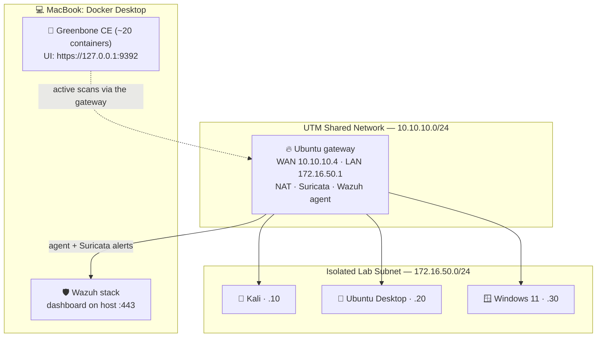

## 3. Build Guide

Run everything in the **Mac terminal**.

### Step 1: Get the official compose file

```bash
mkdir -p ~/greenbone-docker && cd ~/greenbone-docker
curl -O https://greenbone.github.io/docs/latest/_static/docker-compose.yml
```

### Step 2: Pull and start ([Bottleneck 1](#bottleneck-1-image-pulls-time-out-context-deadline-exceeded))

```bash
docker compose -f docker-compose.yml up -d     # if it times out, just run it again
```

Give Docker Desktop **≥ 6–8 GB RAM**. Greenbone runs about 20 containers next to the Wazuh stack.

### Step 3: Fix the port mapping for a Mac that also runs Wazuh ([Bottlenecks 2–5](#bottleneck-2-dashboard-refuses-to-connect))

In `docker-compose.yml`:

- **`nginx`**: publish only `127.0.0.1:9392:443` (remove `127.0.0.1:443:443` and `127.0.0.1:9392:9392`).
- **`gsad`**: publish **no** ports.

See [`configs/docker-compose-port-fix.yml`](configs/docker-compose-port-fix.yml) for the exact blocks. Then:

```bash
docker compose down --remove-orphans
docker compose -f docker-compose.yml up -d
```

### Step 4: Log in and change the default password

Open **`https://127.0.0.1:9392`**, accept the self-signed certificate, and log in as `admin` / `admin`. **Change the password immediately:**

```bash
docker compose -f docker-compose.yml exec -u gvmd gvmd gvmd --user=admin --new-password='<a-strong-password>'
```

### Step 5: Wait for the feeds

Go to **Administration → Feed Status** and wait until every feed shows **Current**. The first sync can take a long time, and scans before that will miss most vulnerabilities.

## 4. Bottlenecks & How They Were Resolved

| # | Symptom | Root cause | Fix |
|---|---|---|---|
| 1 | `context deadline exceeded` during pull | Greenbone's registry drops many large parallel downloads | Re-run `up -d`; finished layers are kept |
| 2 | `ERR_CONNECTION_REFUSED` on `:9392` | The web entry point (`nginx`) wasn't running, so nothing listened on 9392 | Find out why nginx can't start (→ #5) |
| 3 | `ERR_CONNECTION_CLOSED` / `ERR_EMPTY_RESPONSE` | Wrong turn: `gsad` was exposed directly, but it's **HTTP-only and API-only** | Don't publish `gsad`; the UI goes through nginx |
| 4 | *port is already allocated* even after `down` | The `gsad` mapping from #3 took 9392; Docker Desktop kept stale bindings | Remove the `gsad` port; restart Docker Desktop |
| 5 | `bind: address already in use` on **443** | The **Wazuh dashboard already owns host port 443** | Don't publish host 443 for Greenbone |
| 6 | `ERR_SSL_PROTOCOL_ERROR` | nginx's port 9392 is plain HTTP; its TLS listener is 443 | Map host `9392` → container **`443`** |

---

### Bottleneck 1: Image pulls time out: `context deadline exceeded`

**Symptom.** `docker compose pull` failed again and again, with many images erroring out at once:

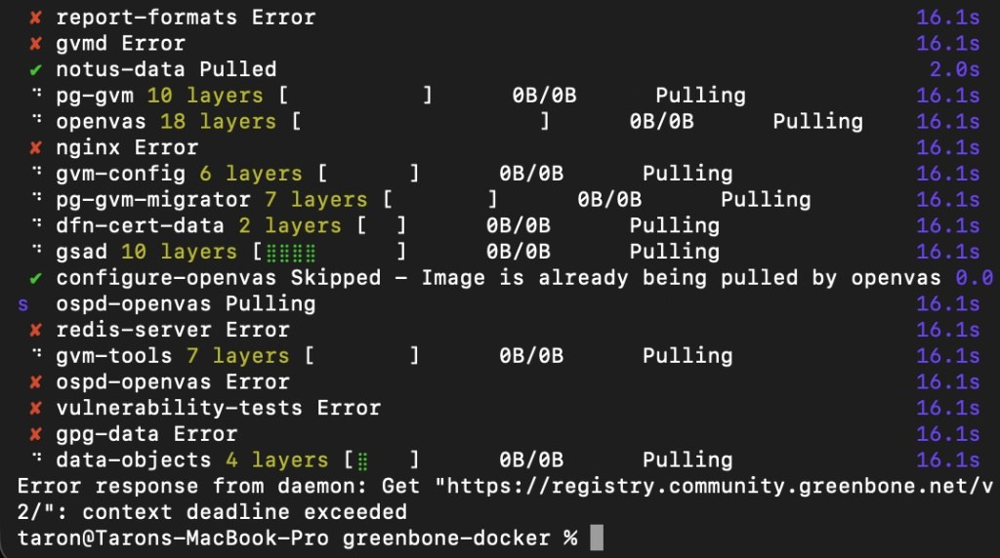

```text
Error response from daemon: Get "https://registry.community.greenbone.net/v2/": context deadline exceeded
```

**Root cause.** The Greenbone stack is about 20 large images from Greenbone's own registry. Pulling them all in parallel regularly times out.

**Fix.** Just **run `docker compose up -d` again**. Docker keeps every layer that already finished, so each retry gets further. It completed after a few runs.

Two side notes:

- `docker compose up --parallel 1` **doesn't exist** (*unknown flag*), despite being suggested.
- `docker system prune -f` is safe for **running** containers, but it deletes **all stopped containers** and dangling images. If the Wazuh stack happens to be stopped, its containers are removed (its named volumes are kept, so `docker compose up -d` recreates them). Prefer a targeted cleanup.

---

### Bottleneck 2: Dashboard refuses to connect

**Symptom.** Docker Desktop showed the Greenbone stack running (15 containers), but the browser got `ERR_CONNECTION_REFUSED` on `127.0.0.1:9392`:

| Stack "running" | Browser |
|---|---|
| 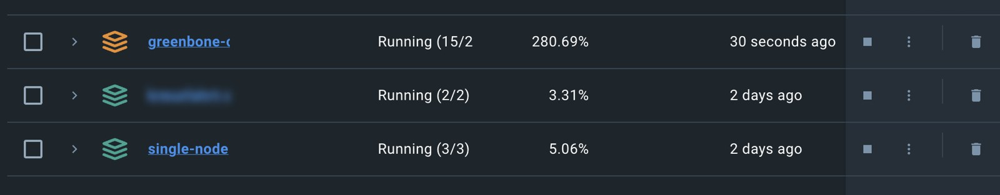 |  |

**Root cause.** `docker compose port nginx 80` answered *service "nginx" is not running*, and no Greenbone container had a published port. In the official compose file, **`nginx` is the only way into the UI**, and it wasn't running. The reason became clear later ([Bottleneck 5](#bottleneck-5-port-443-is-already-taken-by-the-wazuh-dashboard)): it couldn't bind host port 443.

---

### Bottleneck 3: Wrong turn: exposing `gsad` directly

**What was tried.** Since nginx wasn't running, the suggested fix was to publish the `gsad` container (the GSA daemon) straight to `127.0.0.1:9392:80`.

**Why it can't work.** The `gsad` service in the official compose file runs with:

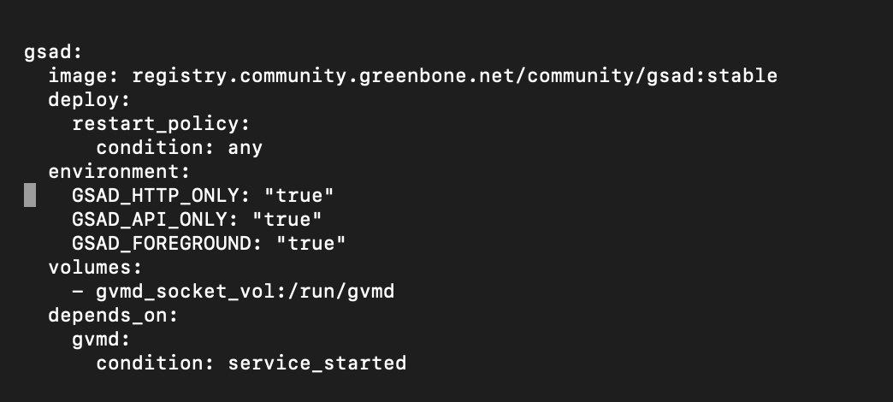

- `GSAD_HTTP_ONLY: "true"`: plain HTTP, so `https://` fails with `ERR_CONNECTION_CLOSED`.
- `GSAD_API_ONLY: "true"`: it serves **only the API**, not the web pages. The pages are static files served by **nginx**, so even plain `http://` got `ERR_EMPTY_RESPONSE`.

| Port added to `gsad` | `https://` → closed | `http://` → empty |
|---|---|---|
| 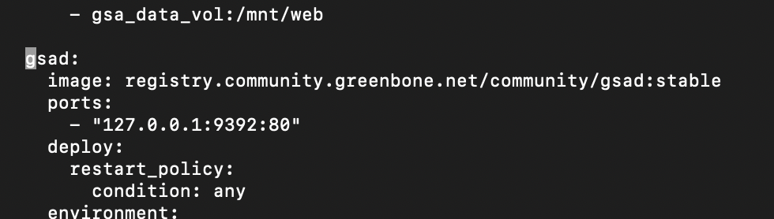 | 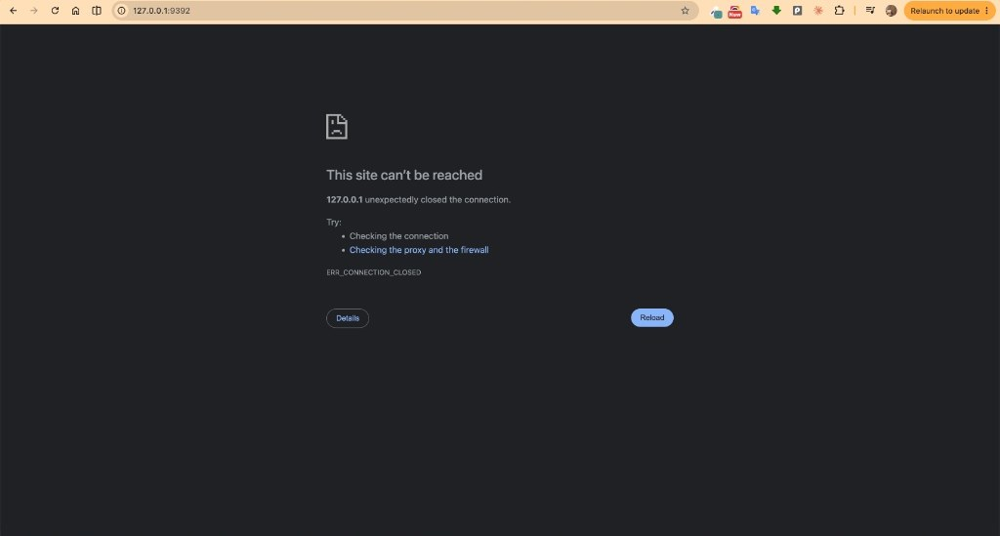 | 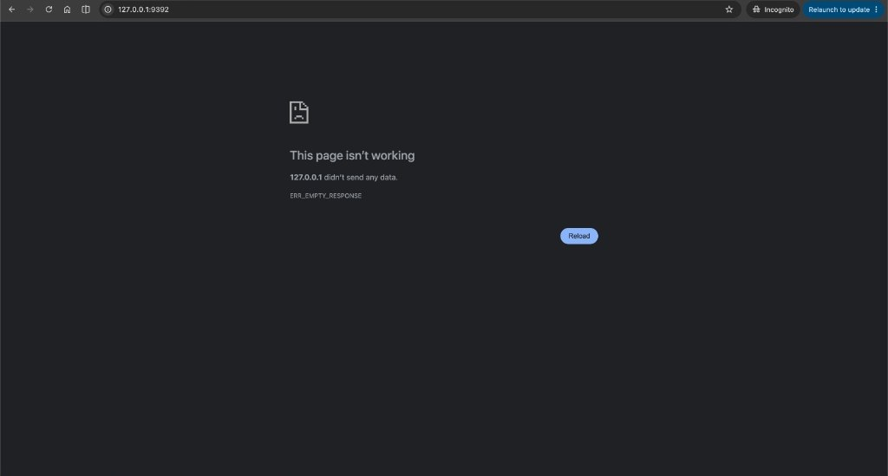 |

**Fix.** Undo it. `gsad` stays internal, and nginx proxies to it.

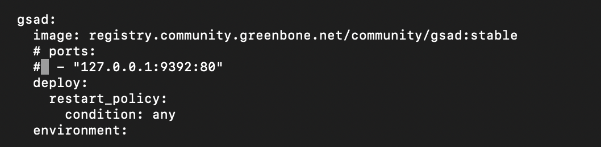

> A second suggestion was to **delete the whole `nginx` block**. Don't: nginx is the web front end. Looking at the actual file before deleting anything is what stopped that mistake.

---

### Bottleneck 4: "port is already allocated", even after `docker compose down`

**Symptom.** Every `up -d` ended with:

```text
Bind for 127.0.0.1:9392 failed: port is already allocated
```

**Root cause.** Two things were fighting over 9392. First, the `gsad` mapping from Bottleneck 3 had taken 9392, so nginx couldn't bind it (`docker ps -a | grep 9392` showed `gsad-1` holding it). Second, after several failed runs, Docker Desktop's network proxy (`com.docker…`, seen with `sudo lsof -i :9392`) kept the old binding even after `docker compose down`.

**Fix.** Remove the `gsad` port mapping, then restart Docker Desktop to clear the stale bindings:

```bash
killall Docker && open /Applications/Docker.app
```

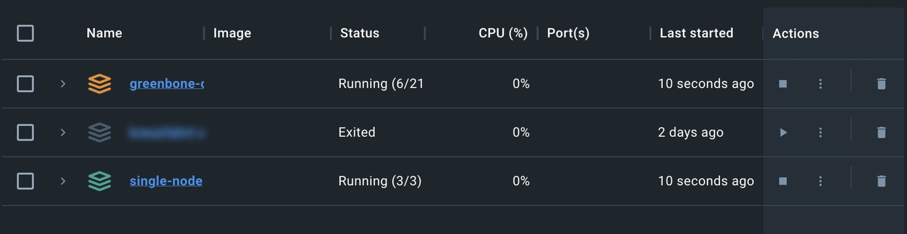

---

### Bottleneck 5: Port 443 is already taken by the Wazuh dashboard

**Symptom.** With 9392 finally free, nginx failed on a different port:

```text
listen tcp4 127.0.0.1:443: bind: address already in use
```

**Root cause.** The official nginx service publishes **both** `127.0.0.1:443:443` and `127.0.0.1:9392:9392`:

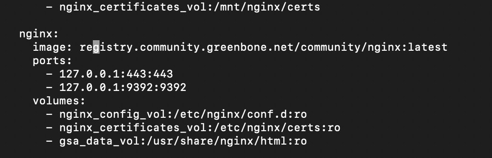

Host port **443 already belongs to the Wazuh dashboard** from [Part 1](../part-1-wazuh-siem/README.md) (`0.0.0.0:443->5601/tcp`). Two containers can't publish the same host port. This was the hidden reason nginx never started in Bottleneck 2. (Gemini guessed a macOS service was using 443; the Wazuh dashboard is the real owner.)

**Fix.** Stop publishing host 443 for Greenbone:

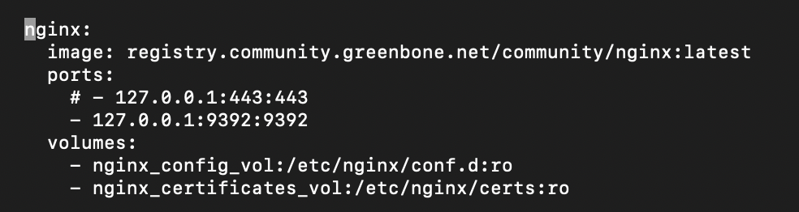

---

### Bottleneck 6: `ERR_SSL_PROTOCOL_ERROR`

**Symptom.** The stack finally started cleanly, but `https://127.0.0.1:9392` gave:

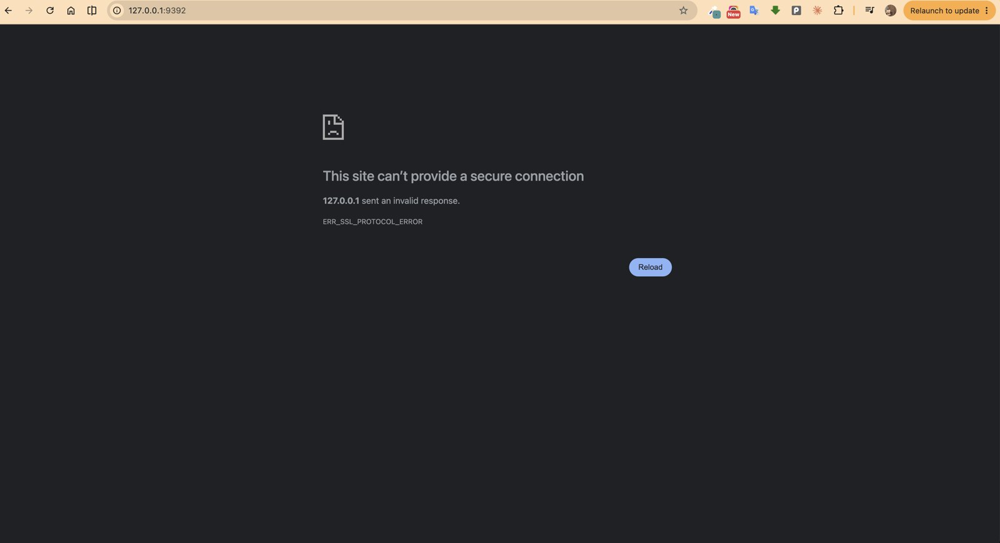

**Root cause.** Inside the nginx container, **443 is the TLS listener**, and **9392 is plain HTTP** (it only redirects to 443). With `9392:9392`, the browser was talking TLS to a plain-HTTP port.

**Fix.** Point host `9392` at nginx's **TLS port**:

```yaml
nginx:
  ports:
    # - 127.0.0.1:443:443     # Wazuh owns host 443
    - 127.0.0.1:9392:443      # host 9392 → nginx TLS
```

```bash
docker compose down --remove-orphans
docker compose -f docker-compose.yml up -d
```

**Result:** `https://127.0.0.1:9392` loads the Greenbone login page. The stack runs **next to Wazuh on the same Docker Desktop**, with no port conflicts. 🎉

## 5. First Scans: One Task per VM

With the dashboard working, every lab VM was added as its own **target**, and each target got its own **scan task** (*Scans → Tasks*). Separate tasks give one report per machine, so results don't get mixed together and each VM can be re-scanned on its own.

| Task | Target VM | Role |
|---|---|---|
| **Ubuntu Live Server (Gateway)** | Ubuntu Server gateway | Router, NAT, Suricata sensor |
| **Kali Linux** | `172.16.50.10` | Attacker VM |
| **Scan Ubuntu Desktop** | `172.16.50.20` | Client VM |
| **Windows 11** | `172.16.50.30` | Client VM |

> 💡 Scanning only the gateway's IP scans only the gateway. Machines behind a router aren't included automatically, so each VM (or the whole `172.16.50.0/24` range) must be a target of its own.

### Results

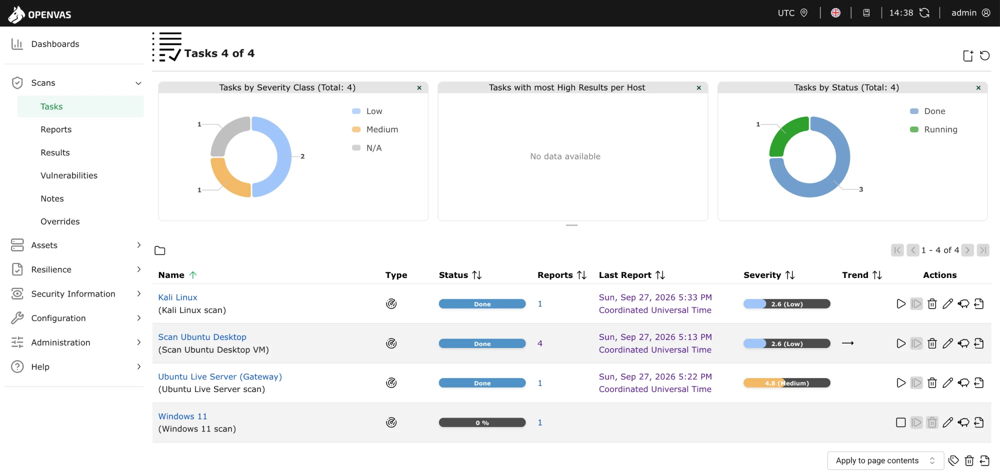

| Task | Status | Reports | Highest severity (CVSS) |
|---|---|---|---|
| Ubuntu Live Server (Gateway) | ✅ Done | 1 | 🟠 **4.8 Medium** |
| Kali Linux | ✅ Done | 1 | 🔵 2.6 Low |
| Scan Ubuntu Desktop | ✅ Done | 4 (re-scanned, trend stable →) | 🔵 2.6 Low |
| Windows 11 | ⏳ Running (0 % when captured) | 1 | pending |

**Reading the results:**

- **The gateway is the most exposed machine.** It's the only one with a *Medium* finding, which makes sense: it's the one VM that sits on two networks and runs the most services (SSH, routing, Suricata, the Wazuh agent). Hardening it gives the biggest improvement.
- **The client VMs are in good shape.** Kali and Ubuntu Desktop only show *Low* findings. Nothing is *High* or *Critical* (the *Tasks with most High Results per Host* chart is empty).
- **Re-scanning shows the trend.** Ubuntu Desktop was scanned four times with a stable result (→). After hardening a machine, re-running its task and checking that the trend goes down proves the fix worked.
- **Windows scans take longest.** Windows exposes many services (SMB, RPC and more) and runs thousands of checks. The Windows firewall can also silently drop probes, and the scanner waits for each one to time out.

## 6. Status & Next Steps

**Done ✅**

- [x] Greenbone Community Edition running in Docker on the MacBook, alongside Wazuh
- [x] Web UI reachable at `https://127.0.0.1:9392`, logged in as admin
- [x] All four lab VMs added as targets, one scan task each
- [x] First reports: gateway **4.8 Medium**, Kali and Ubuntu Desktop **2.6 Low**

**Next**

- [ ] **Change the default `admin` password** (Step 4 above).
- [ ] **Let the Windows 11 scan finish** and add its result.
- [ ] **Fix the gateway's Medium finding.** Open the report, apply the fix, re-scan, and confirm the severity drops.
- [ ] **Keep the feeds current** (*Administration → Feed Status*). Scans are only as good as the latest vulnerability tests.
- [ ] **Try an authenticated scan** (SSH credentials for the Linux VMs). It sees installed package versions, not just open ports, and usually finds much more.
- [ ] **Correlate the three tools.** A scan is noisy on purpose: Suricata on the gateway should raise alerts for it in Wazuh. Checking that proves the whole pipeline works end to end.

## 7. Lessons Learned

- **Know which container is the front door.** In Greenbone CE, `nginx` serves the UI and terminates TLS. `gsad` is an internal, API-only backend. Exposing the wrong one wasted most of the time.
- **Two stacks on one Docker host means checking host ports first.** Before adding a stack, list what's taken (`docker ps --format '{{.Names}} {{.Ports}}'`). Wazuh already owned 443.
- **Port numbers don't tell you the protocol.** 9392 on the host must map to the container port that actually speaks TLS (443), not the one with the same number.
- **Read the real config before deleting anything.** The advice to remove the nginx block would have broken the UI; the screenshot of the actual file showed why.
- **One target, one task.** Scanning the gateway doesn't scan what's behind it, and per-VM tasks give per-VM reports and trends.
- **Retry large pulls instead of changing settings.** Docker keeps finished layers, so each `up -d` gets further.
- **Know what `docker system prune` deletes** before running it on a machine that hosts other projects.

---

⬅️ [Back to overview](../README.md) · Previous: [Part 2: Suricata NIDS integration](../part-2-suricata-nids/README.md)

*Personal learning lab. Only scan systems you own or are authorized to test.*
